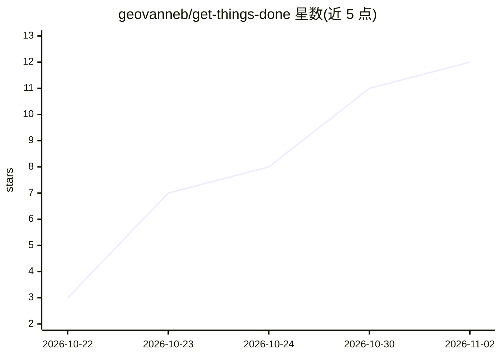

# geovanneb/get-things-done

⭐ 12 · TypeScript · MIT · 推送 2026-11-01 · [GitHub](https://github.com/geovanneb/get-things-done) · [官网](https://www.npmjs.com/package/@bertonha/getthingsdone) · 个人维护

**面向高管的本地 GTD 工作区：Markdown 文件加看板供 AI 代理读写**

将本机一个文件夹组织为结构化高管工作区：个人画像、干系人档案与组织架构图、背景知识库、输出模板与任务，全部以 Markdown/YAML 前置元数据存储；通过 gtd 命令启动本地看板仪表盘（绑定 127.0.0.1，无账号无云端无遥测）。Claude Code、Copilot、Codex 等代理可直接读取同一批文件并按任务生成交付物，代理仅能推进到 in_review，完成状态由用户设定。上下文更新以 diff 形式供用户逐条接受或拒绝。

## 筛选速览

| 维度 | 判定 | 备注 |
|---|---|---|
| AI 角色 | `ai-enhanced` | 去掉 AI 部分产品仍成立 |
| 许可风险 | `permissive` | MIT |
| 部署形态 | `library` | 以包/库形式分发 |
| 模型依赖 | — | README 未给出锁定关系 |
| 硬件要求 | — | 无带数字的原话,不猜 |
| 安装摩擦 | `low` | 无编译、无系统依赖或容器化 |
| 成熟度 | — | 结构信号不足 |

## 能力要点

- 工作区为纯 Markdown 文件，代理原生读取，无需插件或 MCP 服务器
- 服务器绑定 127.0.0.1，无账号、无云端同步、无遥测
- 干系人影响力分级（decision_maker/influencer/informed/executor）驱动代理写作风格
- 代理不可将任务标记为 done，只能推进到 in_review

## 适用场景

- 高管用看板管理任务，让 AI 代理按模板产出会议简报、周报等交付物
- 将会议材料导入并让代理提出上下文更新建议，逐条审阅
- 本地保存个人画像与干系人资料，供任意 AI 助手复用

## 场景标签

`AI 助手` `知识库管理` · 领域:对话与助手

## 证据(README 行号)

> L32: It turns a folder on your machine into a structured executive workspace: your
> L35: is plain Markdown in a folder you own, Claude Code, GitHub Copilot and Codex read the

## 星数曲线

2026-10-22 3 → 2026-11-02 12（+9）

---
*卡片 v1 · prompt 1.4 · 生成 2026-11-02 · 置信度 high · 依据 README sha `9f3598601780` · [字段定义](../../DATASET.md)*
