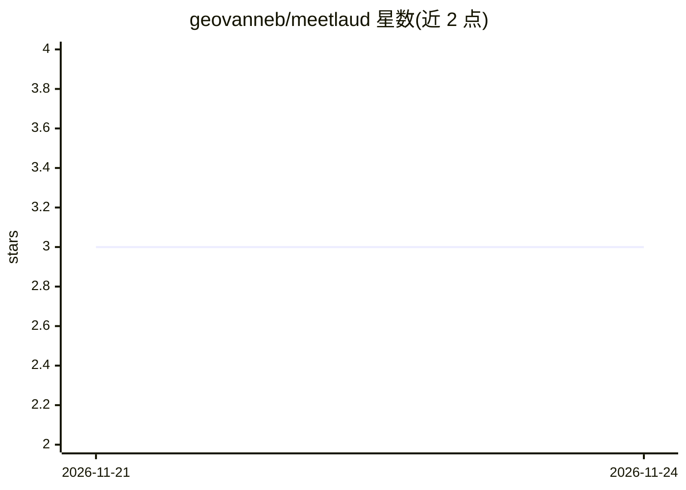

# geovanneb/meetlaud

⭐ 3 · Swift · Apache-2.0 · 推送 2026-11-22 · [GitHub](https://github.com/geovanneb/meetlaud) · 个人维护

**iOS/Android 离线会议记录应用：录音、转写、区分说话人、摘要与提问全在本机**

由两个原生应用（Swift 6/SwiftUI 与 Kotlin/Jetpack Compose）组成的开源会议记录工具：一键录音（锁屏后台持续、崩溃恢复、导入音频），用 Whisper 或 Apple Speech 转写四种语言，基于声纹区分说话人，按模板生成摘要并把要点链接到时间点，支持对单场或整个库提问并给出引用来源。所有 AI 运行在手机本地，模型从 Hugging Face 固定版本下载。限制：摘要与提问需较大内存（iPhone 约 8GB、Android 约 4GB），目前为 pre-release，未上架应用商店，需自行构建。

## 筛选速览

| 维度 | 判定 | 备注 |
|---|---|---|
| AI 角色 | `ai-native` | 本体是模型或模型工具 |
| 许可风险 | `permissive` | Apache-2.0 |
| 部署形态 | `desktop` | 安装包/桌面程序 |
| 模型依赖 | — | README 未给出锁定关系 |
| 硬件要求 | — | 无带数字的原话,不猜 |
| 安装摩擦 | `medium` | 含编译或系统依赖之一 |
| 成熟度 | `idea` | |

## 能力要点

- 录音、转写、说话人识别、摘要、问答全部在本机运行，无账户无服务器
- 摘要与问答的每个要点链接到录音中的时间点，可回听核对
- 网络活动屏幕列出应用全部连接，make check 构建时强制检查
- AI 模型屏幕可按任务选模型、查看设备适配并自测速度

## 适用场景

- 不开联网会议应用，用手机本地记录并转写面谈或课程
- 为销售拜访、面试生成带时间点链接的要点与行动项
- 在飞行模式下对已有录音提问并核对出处

## 场景标签

`语音识别` `文档问答` · 领域:知识与检索

## 证据(README 行号)

> L15: Meetlaud records your meetings, transcribes them, tells you who said what, writes the summary, and answers your que
> L35: Phones are now fast enough to do this work themselves. Meetlaud uses open AI models that run directly on the phone:
> L123: |Summaries and Ask|MLX Swift with Qwen 3.5 2B|llama.cpp with Qwen 3.5 2B|Apache-2.0|

## 星数曲线

2026-11-21 3 → 2026-11-24 3（+0）

---
*卡片 v1 · prompt 1.4 · 生成 2026-11-22 · 置信度 high · 依据 README sha `640dad92c5df` · [字段定义](../../DATASET.md)*
