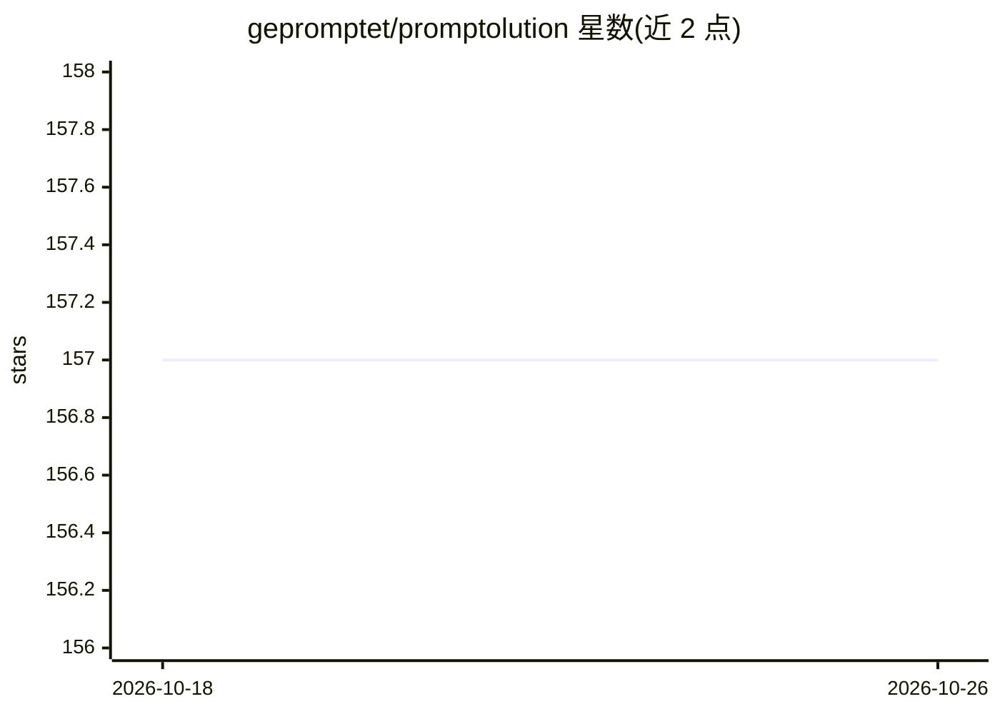

# gepromptet/promptolution

⭐ 157 · Python · Apache-2.0 · 推送 2026-09-24 · [GitHub](https://github.com/gepromptet/promptolution) · [官网](https://gepromptet.github.io/promptolution/) · 组织维护

**面向研究者的模块化提示词优化框架**

面向研究者与高级实践者的提示词优化框架，聚焦优化阶段本身而非端到端应用：内置 CAPO、EvoPromptDE、EvoPromptGA、OPRO 等优化器，提供统一 LLM 后端（API 模型、本地 LLM、vLLM 集群）、响应缓存与并行推理、token 用量跟踪。既可用一行 optimize 调用完成分类任务优化，也可手动组装 Task/Predictor/LLM/Optimizer 组件，并支持基于 Hydra 的配置驱动实验（本地或 SLURM）。由 LMU Munich、MCML、ELLIS、TUM、Uni Freiburg 团队开发，相关论文发表于 EACL 2026。

## 筛选速览

| 维度 | 判定 | 备注 |
|---|---|---|
| AI 角色 | `ai-ecosystem` | LLM/agent 周边工具 |
| 许可风险 | `permissive` | Apache-2.0 |
| 部署形态 | `library` | 以包/库形式分发 |
| 模型依赖 | local-ok | 支持本地模型 |
| 硬件要求 | — | 无带数字的原话,不猜 |
| 安装摩擦 | `low` | 无编译、无系统依赖或容器化 |
| 成熟度 | — | 结构信号不足 |

## 能力要点

- 内置 CAPO/EvoPromptDE/EvoPromptGA/OPRO 等提示词优化器
- 统一 LLM 后端支持 API 模型、本地 LLM 与 vLLM 集群
- 响应缓存与并行推理、token 用量跟踪与详细日志
- Hydra 配置驱动实验与网格运行（本地/SLURM），支持结果文件与重启

## 适用场景

- 在自己的分类任务上自动优化提示词
- 复现或对比多种提示词优化算法
- 开展大规模可复现的提示词优化基准实验

## 场景标签

`提示工程` · 领域:Agent 开发

## 证据(README 行号)

> L19: **Promptolution** is a unified, modular framework for prompt optimization built for researchers and advanced practi
> L25: - Implementation of many current prompt optimizers out of the box.

## 星数曲线

2026-10-18 157 → 2026-10-26 157（+0）

---
*卡片 v1 · prompt 1.4 · 生成 2026-10-23 · 置信度 high · 依据 README sha `d657a3adccf1` · [字段定义](../../DATASET.md)*
