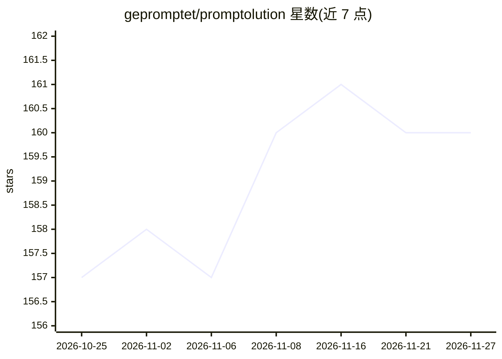

# gepromptet/promptolution

⭐ 160 · Python · Apache-2.0 · 推送 2026-10-27 · [GitHub](https://github.com/gepromptet/promptolution) · [官网](https://gepromptet.github.io/promptolution/) · 组织维护

**面向研究者的模块化提示词优化框架**

promptolution 是一个专注于提示词优化阶段的模块化框架，面向需要完全控制实验设置的研究者与高级实践者。它内置多种现有提示词优化器（CAPO、EvoPrompt、OPRO 等），提供统一的 LLM 后端接口（API 模型、本地模型、vLLM 集群），支持响应缓存、并行推理与 token 用量追踪。提供从一行调用到组件级手动构建的三种使用方式，并通过 Hydra 配置驱动支持可复现的基准实验，可在本地或 SLURM 上运行。

## 筛选速览

| 维度 | 判定 | 备注 |
|---|---|---|
| AI 角色 | `ai-ecosystem` | LLM/agent 周边工具 |
| 许可风险 | `permissive` | Apache-2.0 |
| 部署形态 | `library` | 以包/库形式分发 |
| 模型依赖 | local-ok | 支持本地模型 |
| 硬件要求 | — | 无带数字的原话,不猜 |
| 安装摩擦 | `low` | 无编译、无系统依赖或容器化 |
| 成熟度 | — | 结构信号不足 |

## 能力要点

- 内置多种提示词优化器（CAPO/EvoPromptDE/EvoPromptGA/OPRO）
- 统一 LLM 后端支持 API 模型、本地模型与 vLLM 集群
- 响应缓存与并行推理，含日志与 token 用量追踪
- Hydra 配置驱动的实验网格与可复现基准实验（支持 SLURM）

## 适用场景

- 为分类任务自动优化提示词并在留出数据上评分
- 开展大规模可复现的提示词优化基准实验
- 在本地 GPU 或 vLLM 集群上运行优化流程

## 场景标签

`提示工程` · 领域:Agent 开发

## 证据(README 行号)

> L19: **Promptolution** is a unified, modular framework for prompt optimization built for researchers and advanced practi
> L26: - Unified LLM backend supporting API-based models, Local LLMs, and vLLM clusters.

## 星数曲线

2026-10-25 157 → 2026-11-27 160（+3）

---
*卡片 v1 · prompt 1.4 · 生成 2026-11-27 · 置信度 high · 依据 README sha `0844ee9f4037` · [字段定义](../../DATASET.md)*
