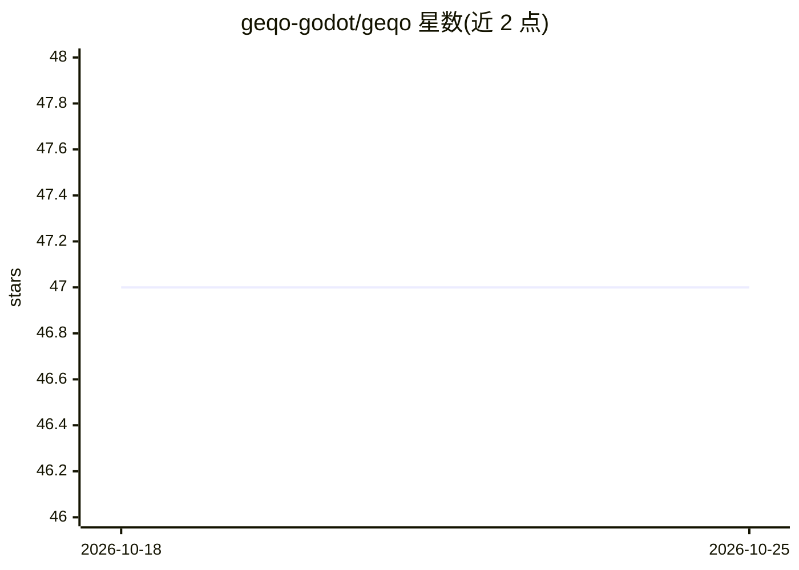

# geqo-godot/geqo

⭐ 47 · GDScript · MIT · 推送 2026-05-18 · [GitHub](https://github.com/geqo-godot/geqo) · 个人维护

**Godot 4 的节点式环境查询系统，供 AI 角色选取最佳位置**

以 C++ GDExtension 实现的 Godot 4.5+ 插件，提供节点化的环境查询（EnvironmentQuery）：开发者组合 Generators（采样位置来源）与 Tests（如距离、可见性评估），为游戏 AI 角色评估周围世界并选出最佳位置/节点/物品。内置 4 种 contexts、4 种 generators、5 种 tests，可用 GDScript/C# 扩展自定义逻辑，支持 2D/3D 调试图形与跨帧分片处理。安装方式为下载 release 并解包到项目 addons 目录后启用插件。

## 筛选速览

| 维度 | 判定 | 备注 |
|---|---|---|
| AI 角色 | `ai-ecosystem` | LLM/agent 周边工具 |
| 许可风险 | `permissive` | MIT |
| 部署形态 | `None` |  |
| 模型依赖 | — | README 未给出锁定关系 |
| 硬件要求 | — | 无带数字的原话,不猜 |
| 安装摩擦 | `low` | 无编译、无系统依赖或容器化 |
| 成熟度 | — | 结构信号不足 |

## 能力要点

- 节点化组合 Generators 与 Tests 构建查询，工作流类似 Unreal EQS
- C++ GDExtension 实现，使用 PhysicsDirectSpaceState 做快速查询
- 分片（time-sliced）查询处理，将负载分摊到多帧避免卡顿
- 2D/3D 运行时彩色可视化调试，支持 GDScript/C# 自定义扩展

## 适用场景

- 游戏 AI 角色寻找最佳移动/掩体/目标位置
- 在 Godot 场景树中可视化调试环境查询
- 用自定义上下文与测试扩展查询逻辑

## 场景标签

 · 领域:游戏开发/游戏 AI 工具

## 证据(README 行号)

> L3: _Godot Environment Query Orchestrator (GEQO)_ is a node-based environment querying system for Godot 4.5+, inspired b
> L4: It allows AI characters to evaluate the world around them and select the best position/node/item based on customizab

## 星数曲线

2026-10-18 47 → 2026-10-25 47（+0）

---
*卡片 v1 · prompt 1.4 · 生成 2026-10-25 · 置信度 high · 依据 README sha `212e212e440b` · [字段定义](../../DATASET.md)*
