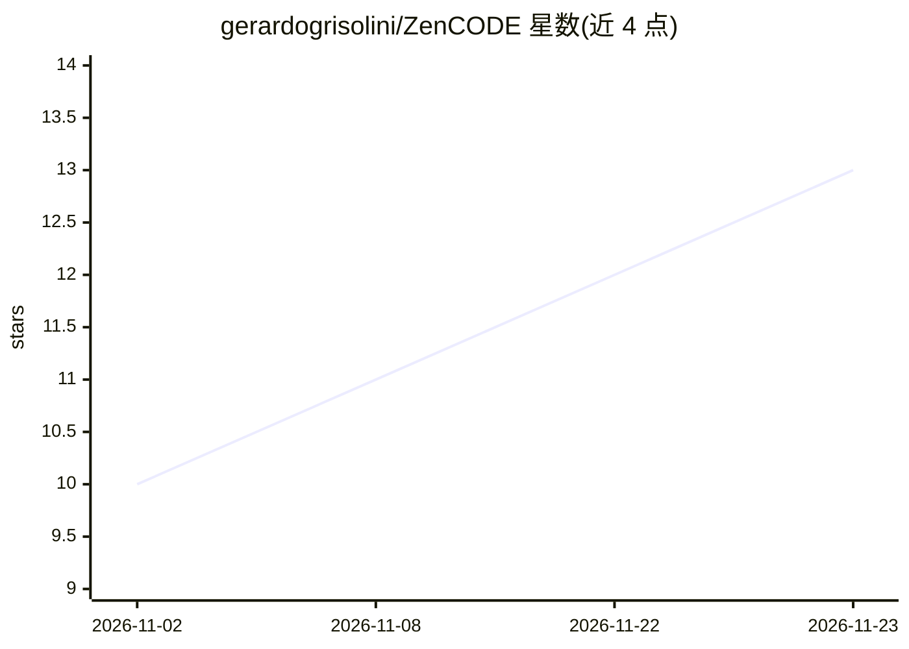

# gerardogrisolini/ZenCODE

⭐ 13 · Swift · MIT · 推送 2026-11-22 · [GitHub](https://github.com/gerardogrisolini/ZenCODE) · [官网](https://github.com/gerardogrisolini/ZenCODE/blob/main/Docs/why-zen.md) · 个人维护

**终端与 ACP 客户端的原生 Swift 编码 agent，单二进制运行**

用 Swift 编写的终端编码 agent，以单个原生二进制分发，无 Node 运行时，面向终端与 ACP 兼容客户端（含 Xcode 27）。核心机制包括：可对话的子 agent 共享聊天室、按能力值（1-10）将任务路由到满足复杂度的最低档模型绑定、按需生成 Swift 包形式的工具、以及 /plan /goal /review 的任务图工作流。模型来源支持任意 OpenAI 兼容端点、ChatGPT/Claude 订阅浏览器登录或本地进程内运行时。项目记忆默认用本地 BM25 检索。

## 筛选速览

| 维度 | 判定 | 备注 |
|---|---|---|
| AI 角色 | `ai-native` | 本体是模型或模型工具 |
| 许可风险 | `permissive` | MIT |
| 部署形态 | `None` |  |
| 模型依赖 | local-ok | 支持本地模型 |
| 硬件要求 | — | 无带数字的原话,不猜 |
| 安装摩擦 | `low` | 无编译、无系统依赖或容器化 |
| 成熟度 | — | 结构信号不足 |

## 能力要点

- 子 agent 并行工作且可通过共享聊天室实时对话（@coordinator / @all）
- 基于能力-复杂度匹配的模型绑定路由，绑定预设批量应用到 profile
- 工具以 Dynamic Swift Feature（编译型 Swift 包）按需生成并进程外运行
- 语音输入输出本地处理，Telegram 远程驱动与 cron 定时 headless 运行

## 适用场景

- 在终端里用多个子 agent 并行编辑代码并通过 swift test 验证
- 按任务复杂度把不同任务分配到不同成本档的模型
- 通过 ACP 把编码 agent 接入 Xcode 27 等客户端
- 在 Raspberry Pi 等受限 ARM 设备上运行编码 agent，推理走远端/本地配置的 provider

## 场景标签

`编码 Agent` · 领域:编码与开发

## 证据(README 行号)

> L7: **ZenCODE** is a native-Swift coding agent built around three ideas: sub-agents you
> L28: - **ACP native** — connects over stdio to compatible clients, including **Xcode 27**, as a native coding agent.
> L29: - **Provider-agnostic** — any OpenAI-compatible endpoint (OpenRouter, local servers, any `/v1` API), or a browser s

## 星数曲线

2026-11-02 10 → 2026-11-23 13（+3）

---
*卡片 v1 · prompt 1.4 · 生成 2026-11-18 · 置信度 high · 依据 README sha `afe3836747f4` · [字段定义](../../DATASET.md)*
