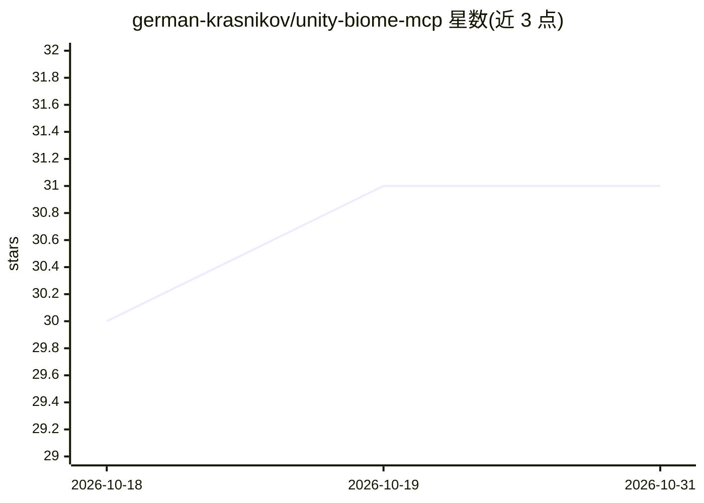

# german-krasnikov/unity-biome-mcp

⭐ 31 · C# · MIT · 推送 2026-10-26 · [GitHub](https://github.com/german-krasnikov/unity-biome-mcp) · [官网](https://german-krasnikov.github.io/unity-biome-mcp/) · 个人维护

**面向 Unity 编辑器的 MCP server，160 个工具控制场景与资产**

让 MCP 兼容的 AI 客户端（Claude Code、Codex、Cursor 等）或 Unity 内置 Chat 控制 Unity 编辑器：Python server 经 stdio 启动，通过 localhost TCP 向编辑器插件发送命令，覆盖 GameObject/组件/材质编辑、PlayTest DSL 运行测试、动画与 VFX 操作、batch 批量操作与视觉基线对比。提供 Setup Wizard 配置多种客户端，Unity 包内含 12 个领域技能与 4 个 agent，支持插件扩展。要求 Unity 6（6000.0+）、Git 2.14+ 与 uv。

## 筛选速览

| 维度 | 判定 | 备注 |
|---|---|---|
| AI 角色 | `ai-ecosystem` | LLM/agent 周边工具 |
| 许可风险 | `permissive` | MIT |
| 部署形态 | `None` |  |
| 模型依赖 | — | README 未给出锁定关系 |
| 硬件要求 | — | 无带数字的原话,不猜 |
| 安装摩擦 | `low` | 无编译、无系统依赖或容器化 |
| 成熟度 | — | 结构信号不足 |

## 能力要点

- 160 个注册 MCP 工具：场景编辑、playtest 验证、动画/VFX、视觉基线对比
- PlayTest DSL 支持 play mode 工作流与编译/控制台检查
- batch 组合兼容操作，带 Undo 回滚与错误处理
- 12 个领域技能与 4 个 agent 可安装到项目（Claude Code/Codex）

## 适用场景

- 用 Claude Code/Cursor 等 AI 客户端直接操作 Unity 编辑器做场景与资产修改
- 在 Unity 内通过 Chat 模式配合场景上下文进行开发
- 运行 playtest 工作流并对比视觉基线验证改动
- 批量执行对象创建与属性设置等兼容操作

## 场景标签

 · 领域:游戏开发/工具链

## 证据(README 行号)

> L5: **Control the Unity Editor from MCP-compatible AI clients or from chat inside Unity.**
> L190: The external path is `MCP client -> Python MCP server -> localhost TCP -> Unity Editor plugin`. In-Unity Chat invo

## 星数曲线

2026-10-18 30 → 2026-10-31 31（+1）

---
*卡片 v1 · prompt 1.4 · 生成 2026-10-26 · 置信度 high · 依据 README sha `ca89a0c8f8a8` · [字段定义](../../DATASET.md)*
