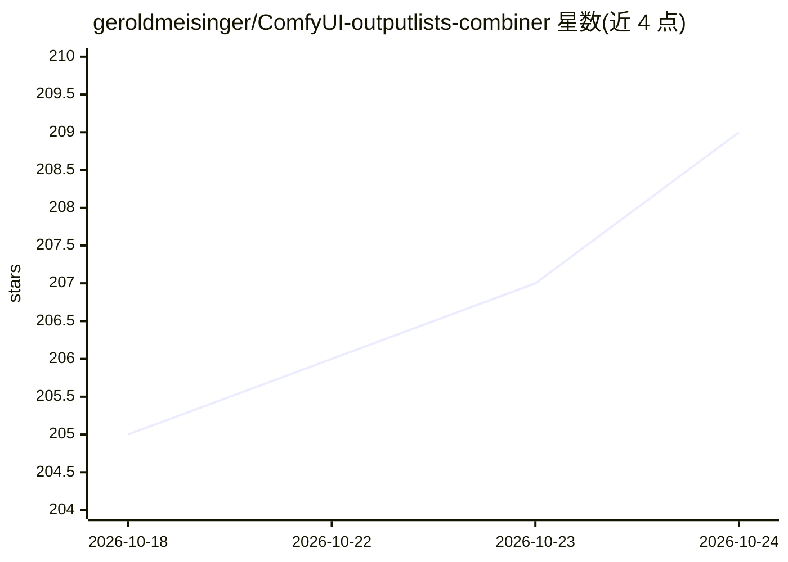

# geroldmeisinger/ComfyUI-outputlists-combiner

⭐ 209 · Python · GPL-3.0 · 推送 2026-09-14 · [GitHub](https://github.com/geroldmeisinger/ComfyUI-outputlists-combiner) · 个人维护

**ComfyUI 自定义节点集：从表格/JSON/文本生成输出列表与组合**

面向 ComfyUI 用户的自定义节点集合，利用 ComfyUI 的 output list 机制实现单次运行内的多资产与多提示词顺序处理：从 CSV/Excel 表格、JSON、多行文本、数字范围生成输出列表；对最多 4 个列表做笛卡尔积组合，支持 LoRA 强度、图像尺寸变体、提示词组合；配合原生 XYZ-GridPlot 绘制网格；另提供 inspect combo 预填 COMBO 值、任意文件 base64 加载与数字转换节点。通过 ComfyUI-Manager、Comfy-CLI 或手动 git clone 安装，Linux 上较新 Skia 版本需安装 libEGL 等系统库。

## 筛选速览

| 维度 | 判定 | 备注 |
|---|---|---|
| AI 角色 | `ai-ecosystem` | LLM/agent 周边工具 |
| 许可风险 | `viral` | GPL-3.0 |
| 部署形态 | `library` | 以包/库形式分发 |
| 模型依赖 | — | README 未给出锁定关系 |
| 硬件要求 | — | 无带数字的原话,不猜 |
| 安装摩擦 | `low` | 无编译、无系统依赖或容器化 |
| 成熟度 | — | 结构信号不足 |

## 能力要点

- 从 CSV/TSV/Markdown/ODS/XLSX/XLS 表格、JSON（JSONPath）、多行文本、数字范围生成 OutputList
- 最多 4 个列表的笛卡尔积组合（OutputLists Combinations）
- 原生 XYZ-GridPlot 网格绘制与 inspect combo 预填 COMBO 值
- Load Any File 以 base64 加载任意文件（含元数据与 glob 模式）

## 适用场景

- 在 ComfyUI 中一次运行批量生成多组提示词或图像变体
- 从电子表格批量读取提示词与参数做顺序生成
- 通过列表组合绘制 LoRA 强度/采样器/检查点的 XYZ 对比网格

## 场景标签

`图像生成` · 领域:内容生成

## 证据(README 行号)

> L69: Did you know that ComfyUI supports so called output lists which tell nodes downstream to execute multiple times wit
> L75: Yeah, I didn't know about it either. Apparently everytime you see the symbol `𝌠` it's an output list. This feature 

## 星数曲线

2026-10-18 205 → 2026-10-24 209（+4）

---
*卡片 v1 · prompt 1.4 · 生成 2026-10-22 · 置信度 mid · 依据 README sha `9d92d35adf83` · [字段定义](../../DATASET.md)*
