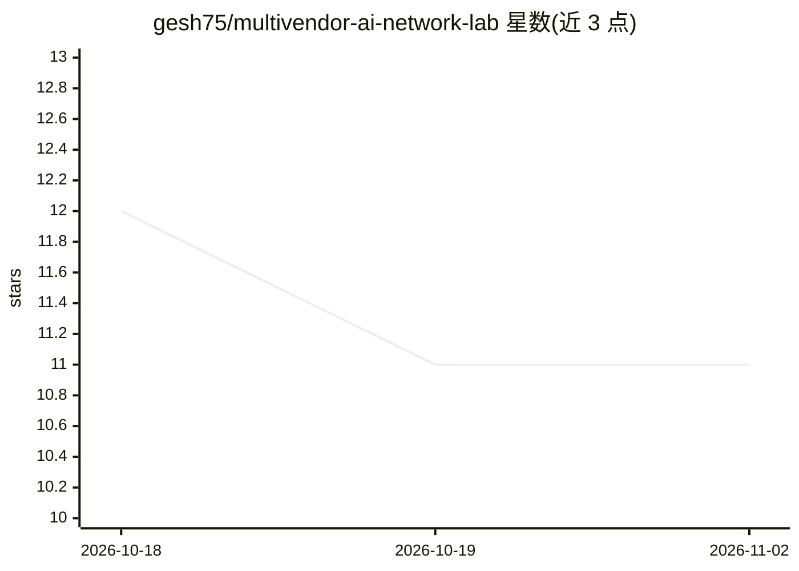

# gesh75/multivendor-ai-network-lab

⭐ 11 · Python · MIT · 推送 2026-10-15 · [GitHub](https://github.com/gesh75/multivendor-ai-network-lab) · [官网](https://gesh75.github.io/multivendor-ai-network-lab/) · 个人维护

**26 设备多厂商网络实验室：AI 编排驱动的闭环网络运维**

面向网络工程师/NetDevOps 的容器化多厂商（Juniper/Arista/FRR）网络实验环境：以 containerlab 与 Docker 模拟 26 台设备，上层为 Flask 单体服务，提供 55 个 /api/mv/* 接口与 69 工具的 MCP 服务器，供 Claude Code 等 AI agent 调用。核心机制包括 Pydantic-AI 多 agent 诊断编排、6 阶段闭环变更管道（Predict→Batfish→Health Gate→Watch→Verify）、RFC 6241 confirmed-commit 自动回滚、风险分级的自动修复（LOW 自动执行，CRITICAL 不自动操作）、GAIT 不可变审计日志与 10 场景评测框架。README 自述为作品集/演示环境而非生产系统；配置 ANTHROPIC_API_KEY 解锁 LLM 功能，无 key 时以确定性离线模式运行。

## 筛选速览

| 维度 | 判定 | 备注 |
|---|---|---|
| AI 角色 | `ai-ecosystem` | LLM/agent 周边工具 |
| 许可风险 | `permissive` | MIT |
| 部署形态 | `None` |  |
| 模型依赖 | locked-api |  |
| 硬件要求 | — | 无带数字的原话,不猜 |
| 安装摩擦 | `low` | 无编译、无系统依赖或容器化 |
| 成熟度 | `idea` | |

## 能力要点

- Pydantic-AI 编排器（Routing/ACL/Incident 多 agent 结构化输出诊断）
- 6 阶段闭环变更管道与 RFC 6241 confirmed-commit 自动回滚
- 69 工具 MCP 服务器，供 Claude Code 等 agent 调用全部能力
- 风险分级自动修复：LOW 自动执行，MEDIUM/HIGH 待审批，CRITICAL 仅告警不自动操作

## 适用场景

- 搭建多厂商 EVPN-VXLAN 实验环境演练网络自动化
- 验证 AI agent 在网络运维闭环（观察→诊断→修复→验证）中的可行性
- 作为 AIOps/NetDevOps 参考实现学习 MCP 集成与审计日志模式

## 场景标签

`多智能体` `模型评测` · 领域:Agent 开发

## 证据(README 行号)

> L101: |⚙️ **MCP server** — 69 tools so Claude Code can call any capability|`src/mcp_dcn_server.py`|coding-networks-blog|
> L133: over a 69-tool MCP server) drive a Flask monolith on `:5757` whose core is a
> L174: POST /api/mv/orchestrator             multi-agent diagnose with structured output

## 星数曲线

2026-10-18 12 → 2026-11-02 11（-1）

---
*卡片 v1 · prompt 1.4 · 生成 2026-11-02 · 置信度 high · 依据 README sha `4af18327895b` · [字段定义](../../DATASET.md)*
