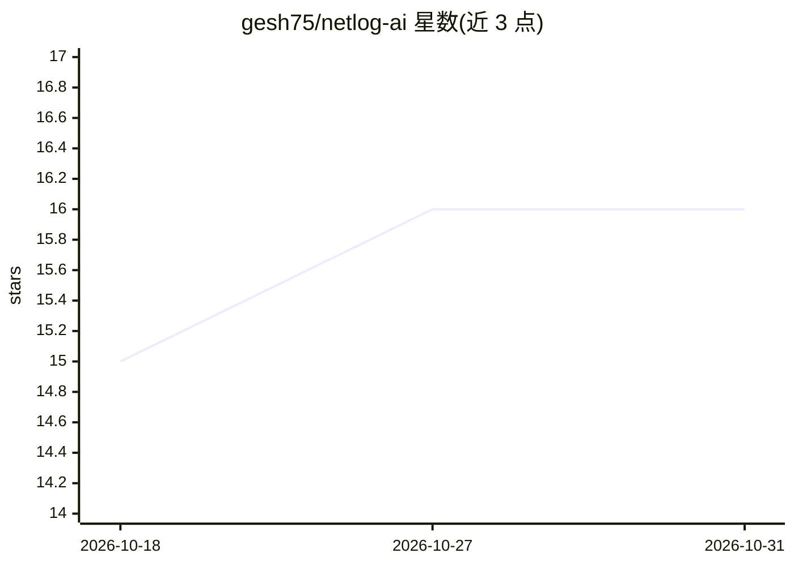

# gesh75/netlog-ai

⭐ 16 · Python · MIT · 推送 2026-10-28 · [GitHub](https://github.com/gesh75/netlog-ai) · [官网](https://gesh75.github.io/netlog-ai/) · 个人维护

**本地化网络日志 AIOps 平台：多厂商 syslog 进、根因与修复方案出**

面向网络运维工程师的本地运行观测平台：接收/拉取 syslog、Kibana、Splunk、Loki、SolarWinds、ServiceNow 等来源的日志，解析 Cisco/Juniper/Arista/Fortinet/Palo Alto 等厂商格式并做跨厂商事件关联，生成带证据引用的根因事件与含回滚步骤的 CLI/Ansible/Nornir 修复方案。LLM 后端可插拔（本地 Docker Model Runner、Anthropic、xAI），出站前先脱敏（密码、公网 IP、SSH 密钥），默认本地 LLM 不回退云端；提供 RBAC、审计日志、流式工单分派与 21+ 个 MCP 工具。v2.2.0 含若干破坏性默认变更。

## 筛选速览

| 维度 | 判定 | 备注 |
|---|---|---|
| AI 角色 | `ai-enhanced` | 去掉 AI 部分产品仍成立 |
| 许可风险 | `permissive` | MIT |
| 部署形态 | `self-host` | docker 或自建部署 |
| 模型依赖 | local-ok | 支持本地模型 |
| 硬件要求 | — | 无带数字的原话,不猜 |
| 安装摩擦 | `low` | 无编译、无系统依赖或容器化 |
| 成熟度 | — | 结构信号不足 |

## 能力要点

- 多厂商 syslog 解析与跨厂商关联（含 BGP/EVPN/SD-WAN 事件）
- 所有 LLM 调用经单一 sanitize-first 网关，敏感信息先脱敏再出站
- 每个发现附带可执行 CLI/Ansible/Nornir 修复与回滚块
- RFC 2439 抖动抑制、Tarjan 关键点爆炸半径等纯标准库深度分析

## 适用场景

- 数据中心/SD-WAN 多厂商环境做 syslog 根因分析
- 将事件自动开单到 Jira/ServiceNow 并同步回写
- 在不外泄配置日志的前提下用 LLM 生成修复方案
- 通过 MCP 工具把网络诊断能力接入 agent 工作流

## 场景标签

 · 领域:网络运维/可观测性

## 证据(README 行号)

> L63: Most "AI for ops" tools either ship your data to a SaaS or hide what the model actually saw. **netlog-ai** runs ent
> L66: - Pluggable LLM backend — **local Docker Model Runner** (Qwen, Llama), **Anthropic Claude**, or **xAI Grok**. No te

## 星数曲线

2026-10-18 15 → 2026-10-31 16（+1）

---
*卡片 v1 · prompt 1.4 · 生成 2026-10-30 · 置信度 high · 依据 README sha `3550c2fb0df4` · [字段定义](../../DATASET.md)*
