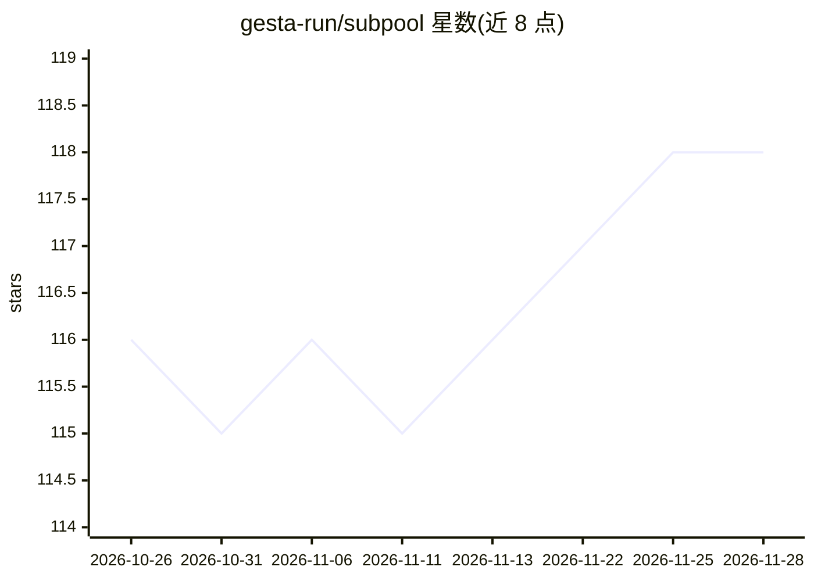

# gesta-run/subpool

⭐ 118 · Go · Apache-2.0 · 推送 2026-11-21 · [GitHub](https://github.com/gesta-run/subpool) · 组织维护

**团队自托管的 AI 订阅额度分配与治理控制面**

Subpool 是一个自托管控制面，管理员将多个订阅账号与 API 账号组合成资源池，为员工分发独立 API key，统一暴露 OpenAI 兼容的 Responses 与 Chat Completions 接口，不存储对话内容。支持账号健康监控、余额/配额展示（OpenAI Costs API、百炼 Token Plan）、限流与密钥吊销、上游凭据加密，以及 Codex/GitHub Copilot 账号的路由与 V2 压缩适配。以 Go 单服务加内嵌 React 控制台与 PostgreSQL 实现，通过 Docker Compose 部署。

## 筛选速览

| 维度 | 判定 | 备注 |
|---|---|---|
| AI 角色 | `ai-ecosystem` | LLM/agent 周边工具 |
| 许可风险 | `permissive` | Apache-2.0 |
| 部署形态 | `desktop` | 安装包/桌面程序 |
| 模型依赖 | — | README 未给出锁定关系 |
| 硬件要求 | — | 无带数字的原话,不猜 |
| 安装摩擦 | `low` | 无编译、无系统依赖或容器化 |
| 成熟度 | — | 结构信号不足 |

## 能力要点

- 将订阅与 API 容量聚合在统一托管端点后，按员工分发 key
- 暴露 OpenAI 兼容 Responses 与 Chat Completions API
- 账号健康、剩余订阅额度与重置状态监控
- 上游凭据加密存储，不持久化提示词与响应内容

## 适用场景

- 团队共享管理多个 AI 订阅账号的额度
- 给员工发独立 key 并独立限流、过期、吊销
- 让 Codex 等客户端统一经由一个网关访问账号池
- 审计密钥与账号的分配关系及 token 用量

## 场景标签

`模型网关` · 领域:Agent 开发

## 证据(README 行号)

> L11: Subpool is a self-hosted control plane for allocating, governing, and auditing AI subscription capacity across team
> L25: - Expose OpenAI-compatible Responses and Chat Completions APIs.
> L35: Subpool is a single Go service with an embedded React console and PostgreSQL persistence.

## 星数曲线

2026-10-26 116 → 2026-11-28 118（+2）

---
*卡片 v1 · prompt 1.4 · 生成 2026-11-28 · 置信度 high · 依据 README sha `963d345e0e70` · [字段定义](../../DATASET.md)*
