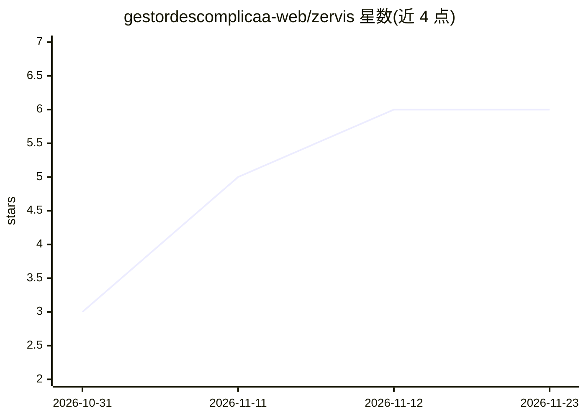

# gestordescomplicaa-web/zervis

⭐ 6 · Python · AGPL-3.0 · 推送 2026-11-20 · [GitHub](https://github.com/gestordescomplicaa-web/zervis) · 组织维护

**面向自动化从业者的语音助手：WhatsApp 接待、代码代理与集成**

运行在 Linux/VPS 上的语音助手服务（systemd 用户服务）：通过语音读取与回复 WhatsApp、驱动 Claude Code 与 Codex 在隔离 Git worktree 中进行代码会话、通过 MCP 连接器接入客户系统与 n8n 流程，并支持本地 Ollama 模型作为后备。所有有影响的操作需语音确认，数据存于本机。要求 Linux、Python 3.12–3.14。

## 筛选速览

| 维度 | 判定 | 备注 |
|---|---|---|
| AI 角色 | `ai-native` | 本体是模型或模型工具 |
| 许可风险 | `viral` | AGPL-3.0 |
| 部署形态 | `None` |  |
| 模型依赖 | local-ok | 支持本地模型 |
| 硬件要求 | — | 无带数字的原话,不猜 |
| 安装摩擦 | `low` | 无编译、无系统依赖或容器化 |
| 成熟度 | `idea` | |

## 能力要点

- 语音驱动 WhatsApp 收件箱、客户调研（SearXNG/Trafilatura 本地搜索）与 CNPJ 查询
- 语音指挥 Claude Code / Codex 在隔离 worktree 中改代码，需用户批准
- MCP 连接器支持 OAuth 与按工具授权，按项目隔离不同客户
- 本地 Ollama（Gemma 4 E4B）作为无需订阅的本地模型路径

## 适用场景

- 通过语音管理客户 WhatsApp 上的销售线索并代为回复
- 语音下指令让 Claude Code 修改网站项目代码
- 语音创建并监控客户的 n8n 自动化流程

## 场景标签

`语音 Agent` `编码 Agent` · 领域:编码与开发

## 证据(README 行号)

> L3:  O assistente de voz que trabalha com você: atende o seu WhatsApp, pesquisa empresas, conduz agentes de código e mos
> L26: Para **gestores e consultores de automação e IA**: quem atende clientes pelo WhatsApp, monta
> L79: |**Sessões com Claude Code e Codex** num terminal real, por projeto, com as suas contas. Cópia isolada (Git worktre

## 星数曲线

2026-10-31 3 → 2026-11-23 6（+3）

---
*卡片 v1 · prompt 1.4 · 生成 2026-11-20 · 置信度 high · 依据 README sha `4422a5b781d2` · [字段定义](../../DATASET.md)*
