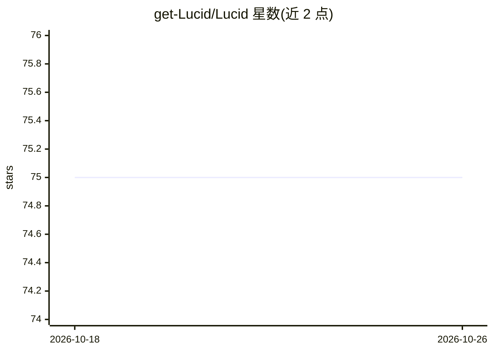

# get-Lucid/Lucid

⭐ 75 · TypeScript · MIT · 推送 2026-03-14 · [GitHub](https://github.com/get-Lucid/Lucid) · [官网](https://getlucid.tech) · 组织维护

**为 AI agent 提供实时验证知识层的 MCP 服务器**

Lucid 是以 MCP 服务器形式运行的智能层，向自主 agent 暴露四个工具：实时文档搜索、包版本与兼容性检查、技术声明事实验证、API 参考获取。配套五个 OpenClaw 技能按对话上下文自动触发对应工具，使 agent 不依赖训练数据作答。使用需在 getlucid.tech 获取 API key，订阅费用为每月 20 USDC（Solana 或 Base 支付），非纯本地运行。安装途径包括 Claude Code 插件市场命令与 openclaw skills install。

## 筛选速览

| 维度 | 判定 | 备注 |
|---|---|---|
| AI 角色 | `ai-ecosystem` | LLM/agent 周边工具 |
| 许可风险 | `permissive` | MIT |
| 部署形态 | `None` |  |
| 模型依赖 | — | README 未给出锁定关系 |
| 硬件要求 | — | 无带数字的原话,不猜 |
| 安装摩擦 | `low` | 无编译、无系统依赖或容器化 |
| 成熟度 | — | 结构信号不足 |

## 能力要点

- MCP 服务器暴露 4 个工具：文档搜索/包检查/事实验证/API 参考
- 5 个技能按对话意图自动触发工具，无需手动调用
- 支持 Claude Code 插件与 OpenClaw Skills 两种安装方式
- 订阅制服务，需 LUCID_API_KEY 认证

## 适用场景

- 让编程 agent 引用实时文档而非过期训练数据
- 开发前核验包的最新版本与兼容性
- 在 agent 回答前验证技术声明的真实性

## 场景标签

`语义搜索` · 领域:知识与检索

## 证据(README 行号)

> L16: AI agents hallucinate. They reference deprecated APIs, recommend outdated package versions and state "facts" from s
> L18: Lucid runs as an MCP server that exposes four tools. When an agent needs documentation, package info, fact verifica

## 星数曲线

2026-10-18 75 → 2026-10-26 75（+0）

---
*卡片 v1 · prompt 1.4 · 生成 2026-10-24 · 置信度 high · 依据 README sha `87bbd162b753` · [字段定义](../../DATASET.md)*
