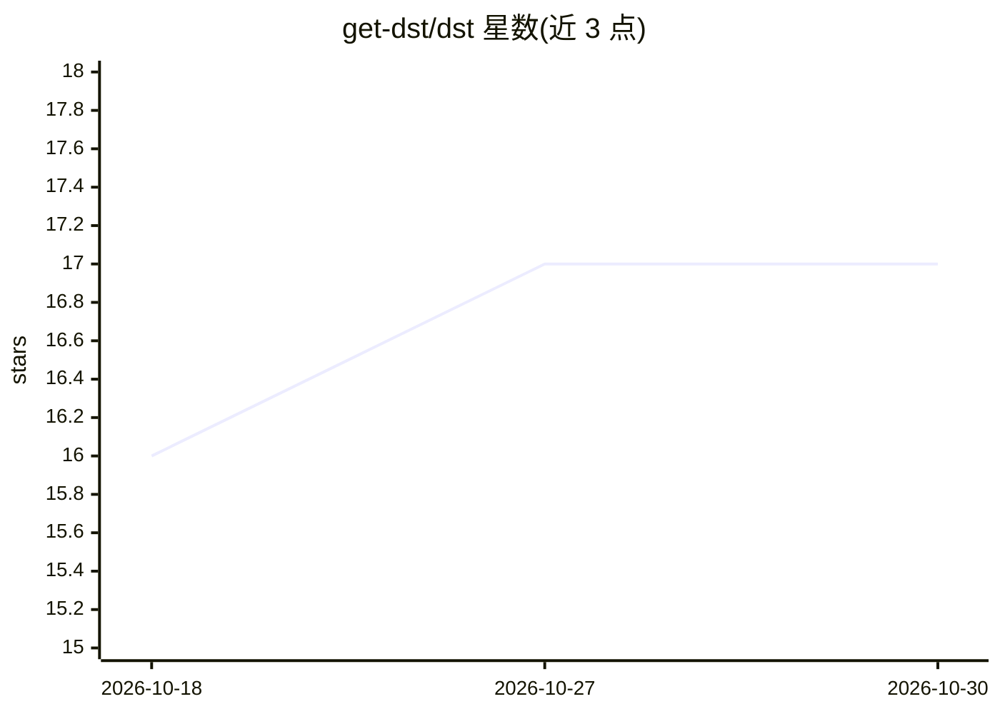

# get-dst/dst

⭐ 17 · Python · Apache-2.0 · 推送 2026-10-24 · [GitHub](https://github.com/get-dst/dst) · [官网](https://www.dataservetool.com) · 组织维护

**开源语义层与 MCP 服务器：让团队 AI 治理化地查询数据仓库**

dst 部署在团队使用的 AI（Claude、ChatGPT、Copilot、自建 agent）与数据仓库（Snowflake、BigQuery、Postgres、DuckDB、MySQL）之间，作为 MCP 服务器提供受治理的数据问答接口：答案附带生成 SQL、置信评级与可验证回执。核心机制为 Lens（按用例声明的服务单元）、认证答案（人工担保的问题→SQL 对，作为回归测试）、以及 plan/apply/test 部署门禁——认证答案偏离时拒绝发布。支持 typed serving（模型不直接写 SQL，而是做槽位决策后编译）。需要 Python 3.12+、Docker（自带 Postgres）与一个模型提供方 API key。

## 筛选速览

| 维度 | 判定 | 备注 |
|---|---|---|
| AI 角色 | `ai-ecosystem` | LLM/agent 周边工具 |
| 许可风险 | `permissive` | Apache-2.0 |
| 部署形态 | `library` | 以包/库形式分发 |
| 模型依赖 | local-ok | 支持本地模型 |
| 硬件要求 | — | 无带数字的原话,不猜 |
| 安装摩擦 | `low` | 无编译、无系统依赖或容器化 |
| 成熟度 | — | 结构信号不足 |

## 能力要点

- 每个数据答案附带 SQL、置信评级与签名回执，可通过 verify_receipt MCP 工具核验
- 人工认证的答案成为回归测试，dst test/apply 时重跑，偏离即阻断部署
- typed serving 模式下模型不写 SQL，而是对 lens 声明的槽位做决策后编译生成
- dst observe 提供逐次调用台账（SQL、结果、双向成本）；dst drift 检测仓库 schema 漂移

## 适用场景

- 让团队已有的 AI 助手安全、可审计地回答数据问题
- 数据团队把语义定义（lens、认证答案）以文件形式声明并通过门禁部署
- 对 AI 数据问答做持续回归测试与合规审计

## 场景标签

`数据分析` · 领域:效率与自动化

## 证据(README 行号)

> L10: In one line: dst (data serve tool) is an open-source semantic layer and MCP
> L12: agents) and your warehouse (Snowflake, BigQuery, Postgres, DuckDB). It is
> L76: - **The server** — `http://localhost:8000`. Agents ask it questions over MCP;

## 星数曲线

2026-10-18 16 → 2026-10-30 17（+1）

---
*卡片 v1 · prompt 1.4 · 生成 2026-10-29 · 置信度 high · 依据 README sha `9d5827c84783` · [字段定义](../../DATASET.md)*
