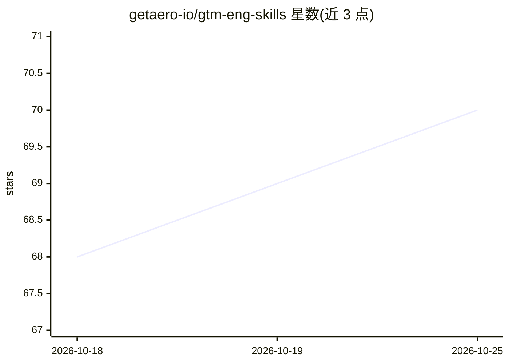

# getaero-io/gtm-eng-skills

⭐ 70 · TypeScript · MIT · 推送 2026-10-24 · [GitHub](https://github.com/getaero-io/gtm-eng-skills) · [官网](https://code.deepline.com) · 组织维护

**面向 Claude Code 的 GTM 工程 agent 技能集（10 个 SKILL.md）**

由 getaero 维护的 GTM（go-to-market）agent 技能集合：以 SKILL.md 格式编码线索富集、信号发现、TAM 构建、LinkedIn 身份校验、外联自动化等 10 个技能，通过自然语言由 Claude Code 自动调用。技能底层依赖 Deepline CLI（需账号登录）编排 Apollo、PDL、Hunter 等 40+ 数据源，内置瀑布式调用顺序、成本优先路由与审批门槛。兼容 Claude Code、Cursor、Codex CLI 等 SKILL.md 格式的 agent；另含云端工作流模板与实验性 drafts 目录。

## 筛选速览

| 维度 | 判定 | 备注 |
|---|---|---|
| AI 角色 | `ai-knowledge` | 知识聚合/清单类 |
| 许可风险 | `permissive` | MIT |
| 部署形态 | `library` | 以包/库形式分发 |
| 模型依赖 | — | README 未给出锁定关系 |
| 硬件要求 | — | 无带数字的原话,不猜 |
| 安装摩擦 | `low` | 无编译、无系统依赖或容器化 |
| 成熟度 | `idea` | |

## 能力要点

- 10 个 GTM 技能：TAM 构建、瀑布式邮箱富集、LinkedIn 身份校验、信号发现等
- 经 Deepline CLI 编排 40+ 数据源，成本感知路由与瀑布回退
- 兼容 Claude Code、Cursor、Codex CLI、Gemini CLI、Antigravity 等 SKILL.md agent
- 提供 Clay 表格迁移到代码化富集脚本的技能

## 适用场景

- 让 Claude Code 直接对我的 CSV 做线索富集与打分
- 构建目标市场（TAM）账户与联系人列表
- 把 Clay 表格配置迁移为本地可运行的富集脚本
- 部署定时/触发的入站线索资格判定云端工作流

## 场景标签

`工作流自动化` · 领域:效率与自动化

## 证据(README 行号)

> L39: Each skill is a markdown file (`SKILL.md`) that encodes:
> L191: These skills work with any AI coding agent that supports the `SKILL.md` format:

## 星数曲线

2026-10-18 68 → 2026-10-25 70（+2）

---
*卡片 v1 · prompt 1.4 · 生成 2026-10-24 · 置信度 high · 依据 README sha `9b17cb0017a4` · [字段定义](../../DATASET.md)*
