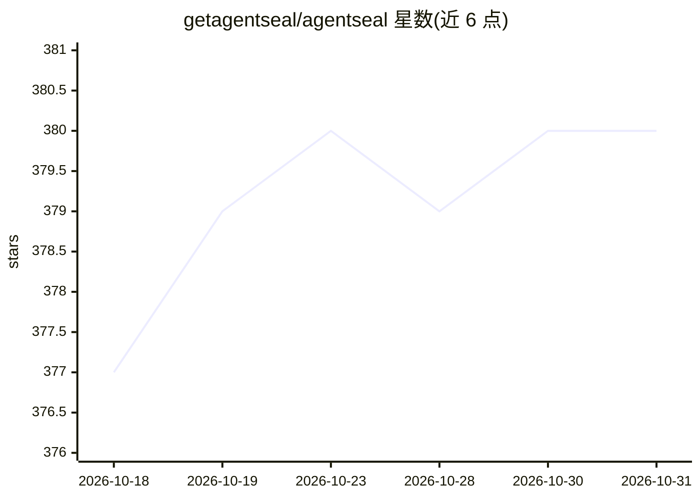

# getagentseal/agentseal

⭐ 380 · Python · NOASSERTION · 推送 2026-06-11 · [GitHub](https://github.com/getagentseal/agentseal) · [官网](https://agentseal.org) · 组织维护

**AI agent 安全工具箱：扫描技能文件与 MCP 配置、测试提示注入抵抗力**

面向 AI agent 开发者与安全团队的 CLI 与 SDK 工具集。guard 扫描本机 28 种 agent 的技能文件、MCP 配置与数据外泄路径（六阶段检测流水线，含反混淆、MiniLM-L6-v2 语义分析、基线哈希）；scan 用 225+ 对抗探针测试系统提示，输出确定性信任分，支持 OpenAI/Anthropic/Ollama 等；scan-mcp 审计在线 MCP 服务器的工具投毒；shield 实时监控配置文件并隔离威胁。guard/shield/scan-mcp 无需 API key 离线运行。Python 与 npm 双发行，另有 Pro 商业扩展。

## 筛选速览

| 维度 | 判定 | 备注 |
|---|---|---|
| AI 角色 | `ai-ecosystem` | LLM/agent 周边工具 |
| 许可风险 | `none` | NOASSERTION |
| 部署形态 | `library` | 以包/库形式分发 |
| 模型依赖 | local-ok | 支持本地模型 |
| 硬件要求 | — | 无带数字的原话,不猜 |
| 安装摩擦 | `low` | 无编译、无系统依赖或容器化 |
| 成熟度 | — | 结构信号不足 |

## 能力要点

- guard 扫描 28 种 AI agent 的技能文件、MCP 配置与供应链变更
- scan 提供 225+ 对抗探针（82 提取 + 143 注入 + 8 变异），无 LLM 评判、结果确定
- scan-mcp 检测 MCP 工具描述投毒，shield 实时监控并隔离文件
- 6,600+ MCP 服务器安全注册表，提供 SARIF/JSON 输出与 CI/CD 集成

## 适用场景

- 扫描本机 agent 配置，发现恶意技能文件或被投毒的 MCP 配置
- 红队测试我的系统提示对注入与提取攻击的抵抗力并接入 CI
- 在接入前查询 MCP 服务器的安全信任分

## 场景标签

`网络安全` · 领域:学习与行业

## 证据(README 行号)

> L40: |`guard`|Scans skill files, MCP configs, toxic data flows, and supply chain changes on your machine|No|
> L41: |`scan`|Tests a system prompt against 225+ adversarial attack probes|Yes\*|

## 星数曲线

2026-10-18 377 → 2026-10-31 380（+3）

---
*卡片 v1 · prompt 1.4 · 生成 2026-10-21 · 置信度 high · 依据 README sha `ceda2e109f72` · [字段定义](../../DATASET.md)*
