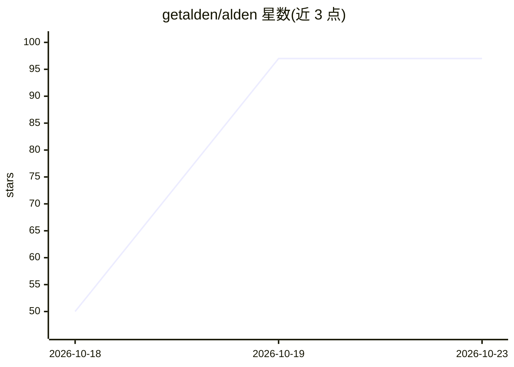

# getalden/alden

⭐ 97 · TypeScript · Apache-2.0 · 推送 2026-10-20 · [GitHub](https://github.com/getalden/alden) · [官网](https://getalden.dev) · 个人维护

**本地运行的 PR 审查助手：排序待审 PR 并定位需关注代码**

面向 GitHub 代码审查者的 CLI 与 macOS 桌面工具：将等待你审查的 PR 按阻塞程度、敏感路径、测试缺失等因素排序分为 Needs you 与 Fast-track 两组；对指定 PR 运行密钥、迁移、依赖、CI 等检查并用 tree-sitter 代码图列出改动公共函数在 diff 外的调用方。可选接入模型（Anthropic/OpenAI/Ollama，可用 --no-llm 跳过）生成变更摘要，按你的反馈调整排序与提示，数据存于本机 ~/.alden。支持 TS/JS、Python、PHP、Go，当前仅支持 GitHub。

## 筛选速览

| 维度 | 判定 | 备注 |
|---|---|---|
| AI 角色 | `ai-enhanced` | 去掉 AI 部分产品仍成立 |
| 许可风险 | `permissive` | Apache-2.0 |
| 部署形态 | `desktop` | 安装包/桌面程序 |
| 模型依赖 | local-ok | 支持本地模型 |
| 硬件要求 | — | 无带数字的原话,不猜 |
| 安装摩擦 | `low` | 无编译、无系统依赖或容器化 |
| 成熟度 | `idea` | |

## 能力要点

- PR 队列按阻塞、敏感路径、CODEOWNERS 等规则排序，每行给出排序理由
- 代码图列出 diff 外调用改签公共 API 的位置（含 Laravel/Symfony 间接调用）
- 根据 Useful/Not useful 反馈学习调整提示与排序，数据仅存本机
- 可发送评论至 GitHub 组成一条 review，模型调用受预算上限约束

## 适用场景

- 按优先级处理积压的待审 PR
- 在审查前先看到改动代码的调用方与需关注点
- 把对代码行的意见汇总为一条 GitHub review 发出

## 场景标签

`代码审查` · 领域:编码与开发

## 证据(README 行号)

> L52: in the diff, and never lets them displace high-severity checks. Use `--model opus` for one review, or `--no-llm` to
> L123: Alden is GitHub-only for now and supports TypeScript/JavaScript, Python, PHP (Laravel, Symfony) and Go.

## 星数曲线

2026-10-18 50 → 2026-10-23 97（+47）

---
*卡片 v1 · prompt 1.4 · 生成 2026-10-23 · 置信度 high · 依据 README sha `12853a2bc15f` · [字段定义](../../DATASET.md)*
