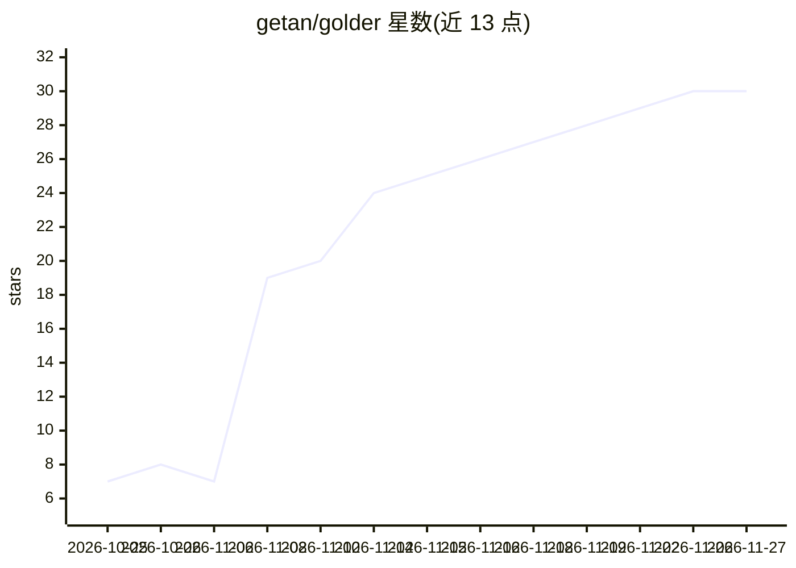

# getan/golder

⭐ 30 · Go · MIT · 推送 2026-11-26 · [GitHub](https://github.com/getan/golder) · [官网](https://golder-cli.pages.dev) · 个人维护 · 中文 README

**Go 编写的开源 AI 编程代理，覆盖桌面/Android/终端**

用 Go 实现的 AI coding agent，提供原生桌面 GUI、Android 客户端与终端/CLI 三类客户端，共享同一 Agent 运行时：可检查代码库、编辑文件、运行命令与测试、操作浏览器。终端侧 golder workspace 提供分屏（agent/shell/浏览器）与命名会话守护进程。安全机制包括可配置审批、凭据脱敏与 OS 沙箱（Linux 需 bubblewrap，macOS 用 sandbox-exec）；浏览器功能需自行安装 Chromium，桌面 Computer Use 开发中。

## 筛选速览

| 维度 | 判定 | 备注 |
|---|---|---|
| AI 角色 | `ai-native` | 本体是模型或模型工具 |
| 许可风险 | `permissive` | MIT |
| 部署形态 | `desktop` | 安装包/桌面程序 |
| 模型依赖 | local-ok | 支持本地模型 |
| 硬件要求 | — | 无带数字的原话,不猜 |
| 安装摩擦 | `low` | 无编译、无系统依赖或容器化 |
| 成熟度 | — | 结构信号不足 |

## 能力要点

- 桌面 GUI、Android 应用（JNI 内嵌 Go Agent、GitHub Actions 出 APK）与终端 CLI 共享 Agent 运行时
- 审批、凭据脱敏与 OS 沙箱等可配置安全边界
- 终端分屏 workspace：agent/shell/浏览器同屏，命名会话带独立守护进程
- SSH/低带宽下自动降级动画并合并刷新以减少终端写入

## 适用场景

- 让 AI 代理在我审批下改代码、跑测试、操作浏览器
- 在终端以分屏方式同时盯 agent、shell 和浏览器
- 在 Android 手机上跑本地会话并用 GitHub Actions 构建 APK
- 在自有复用器（tmux/zellij 等）窗口中运行单 agent 模式

## 场景标签

`编码 Agent` · 领域:编码与开发

## 证据(README 行号)

> L9: Golder is an open-source AI coding agent in Go, available as a native desktop app, an Android app and a terminal/CLI
> L22: 2. **Agent capabilities:** the runtime assembles context, calls a configured model provider, executes tools and con

## 星数曲线

2026-10-25 7 → 2026-11-27 30（+23）

---
*卡片 v1 · prompt 1.4 · 生成 2026-11-18 · 置信度 high · 依据 README sha `7e4df1972c2b` · [字段定义](../../DATASET.md)*
