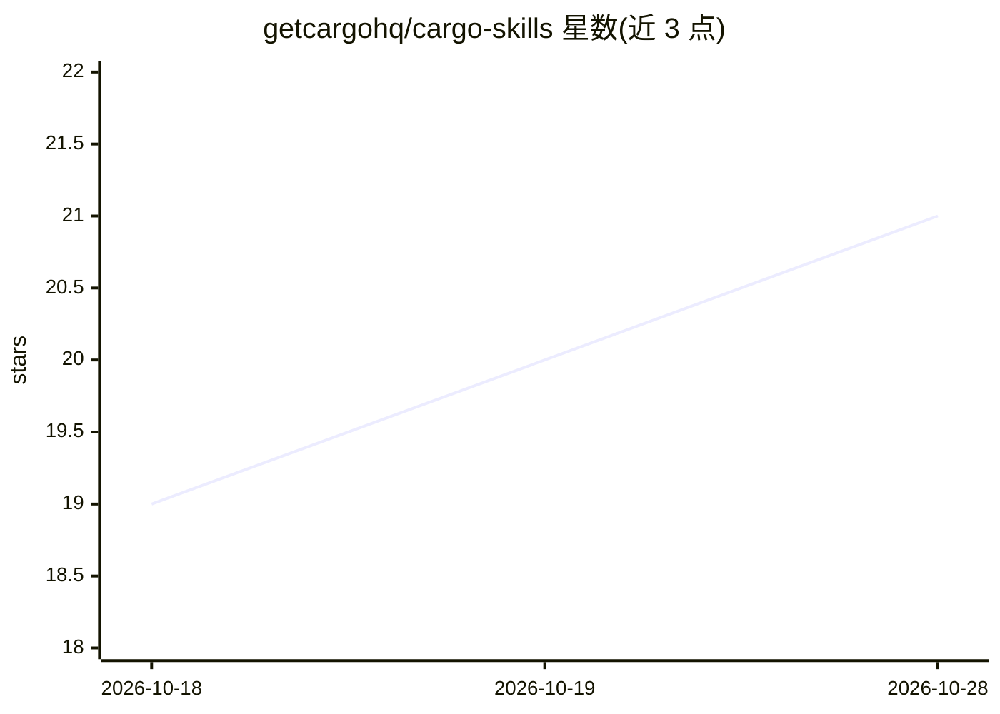

# getcargohq/cargo-skills

⭐ 21 · TypeScript · MIT · 推送 2026-10-28 · [GitHub](https://github.com/getcargohq/cargo-skills) · [官网](https://getcargo.ai) · 组织维护

**给 AI 编码代理的 19 个 GTM 工程技能包：拓客与销售数据工作流**

面向 Claude Code、Codex、Cursor 等 skills.sh 兼容代理的技能集合，把代理变成 GTM 工程工作站：构建潜在客户名单、查找并验证邮箱/电话、供应商瀑布式 enrichment、线索评分、外联撰写、CRM 同步与购买信号监控（职位变动、融资、技术意图）。技能通过 Cargo CLI 运行，依赖 Cargo 平台（148 个集成、55 个按积分计费的数据提供商），新账号赠 100 积分。提供 skills.sh 一行安装、各代理插件市场安装与手动 npm 三条途径，并附带审批钩子、会话生命周期钩子与子代理。

## 筛选速览

| 维度 | 判定 | 备注 |
|---|---|---|
| AI 角色 | `ai-ecosystem` | LLM/agent 周边工具 |
| 许可风险 | `permissive` | MIT |
| 部署形态 | `library` | 以包/库形式分发 |
| 模型依赖 | — | README 未给出锁定关系 |
| 硬件要求 | — | 无带数字的原话,不猜 |
| 安装摩擦 | `low` | 无编译、无系统依赖或容器化 |
| 成熟度 | — | 结构信号不足 |

## 能力要点

- 19 个技能覆盖线索名单构建、邮箱验证、瀑布 enrichment、CRM 同步与信号监控
- 依赖 Cargo CLI 与 Cargo 平台：148 个集成、55 个按次计费数据提供商
- 多渠道安装：skills.sh / Claude Code、Codex、Cursor 插件市场 / OpenClaw ClawHub
- 插件通道提供审批钩子、会话生命周期钩子与两个原生子代理

## 适用场景

- 在编码代理中用自然语言构建并验证销售线索名单
- 把 CSV 用公司规模、融资阶段、技术栈做 enrichment
- 配置购买信号告警（职位变动、融资、技术意图）并把流程定时化

## 场景标签

`工作流自动化` · 领域:效率与自动化

## 证据(README 行号)

> L7: Nineteen agent skills that turn Claude Code, Codex, Cursor, and any skills.sh-compatible agent into a go-to-market e
> L9: They run on the Cargo CLI against Cargo, the AI-native revenue infrastructure: **148 integrations** (HubSpot, Salesf
> L46: npx skills add getcargohq/cargo-skills --all

## 星数曲线

2026-10-18 19 → 2026-10-28 21（+2）

---
*卡片 v1 · prompt 1.4 · 生成 2026-10-28 · 置信度 high · 依据 README sha `63a79d8ee52a` · [字段定义](../../DATASET.md)*
