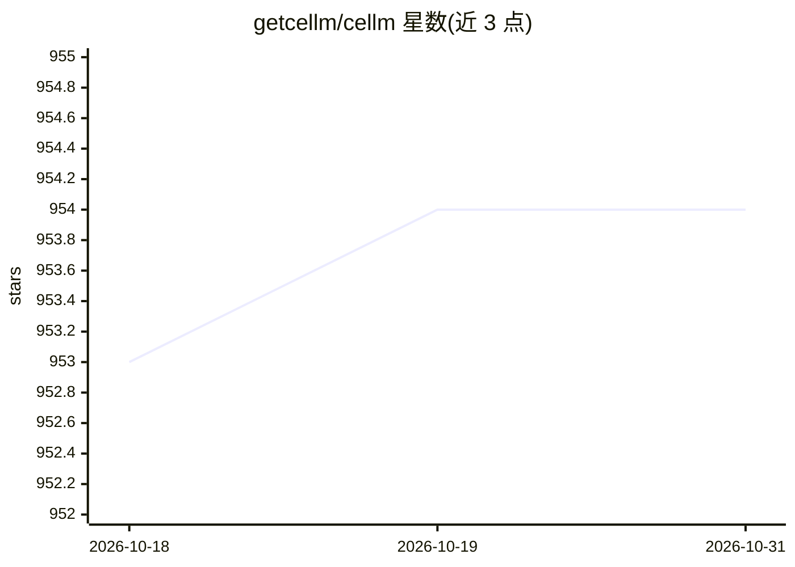

# getcellm/cellm

⭐ 954 · C# · NOASSERTION · 推送 2026-09-07 · [GitHub](https://github.com/getcellm/cellm) · [官网](https://getcellm.com) · 组织维护

**在 Excel 公式中调用 LLM 的加载项，批量处理多行数据**

Cellm 是一个 Windows Excel 扩展，提供 =PROMPT() 公式，对单元格或区域文本运行 LLM 提示并输出结果，可拖拽自动填充批量处理数千行数据。面向不编程的业务用户，用于数据清洗、分类、实体抽取、多语言分析等重复性任务。支持 Azure、AWS、Google、Anthropic、OpenAI、Mistral 等托管模型及 Ollama、Llamafiles、vLLM 本地模型，并可经 MCP 服务器创建网页抓取流程。要求 Windows 10+、.NET 9.0 Runtime、Excel 2010+（桌面版），通过 .msi 安装包安装。免费层使用本地模型或自有 API key，另有面向团队的付费层。采集匿名遥测（崩溃报告与提示词模式），可在配置文件中禁用。

## 筛选速览

| 维度 | 判定 | 备注 |
|---|---|---|
| AI 角色 | `ai-native` | 本体是模型或模型工具 |
| 许可风险 | `none` | NOASSERTION |
| 部署形态 | `desktop` | 安装包/桌面程序 |
| 模型依赖 | local-ok | 支持本地模型 |
| 硬件要求 | — | 无带数字的原话,不猜 |
| 安装摩擦 | `medium` | 含编译或系统依赖之一 |
| 成熟度 | — | 结构信号不足 |

## 能力要点

- =PROMPT() 公式对单元格区域运行 LLM 并支持自动填充批量处理
- 支持 Azure/AWS/Google/Anthropic/OpenAI/Mistral 托管模型与 Ollama/Llamafiles/vLLM 本地模型
- 可通过 MCP 服务器构建自定义网页抓取流程
- 提供 .msi 安装包，安装后在 Excel 内选择 provider 并填入 API key

## 适用场景

- 在表格中批量做文本分类、实体抽取与数据清洗
- 每日抓取并翻译、归类竞品网站标题
- 让非开发团队成员用熟悉的 Excel 自动化重复任务

## 场景标签

`数据分析` `网页抓取` · 领域:效率与自动化

## 证据(README 行号)

> L9: Cellm is an Excel extension that lets you use Large Language Models (LLMs) like ChatGPT in cell formulas. Cellm's `=
> L11: For example, you can write `=PROMPT("Extract all person names mentioned in the text.", A1)` in a cell's formula and
> L67: Cellm supports:

## 星数曲线

2026-10-18 953 → 2026-10-31 954（+1）

---
*卡片 v1 · prompt 1.4 · 生成 2026-10-21 · 置信度 high · 依据 README sha `d005de3770c9` · [字段定义](../../DATASET.md)*
