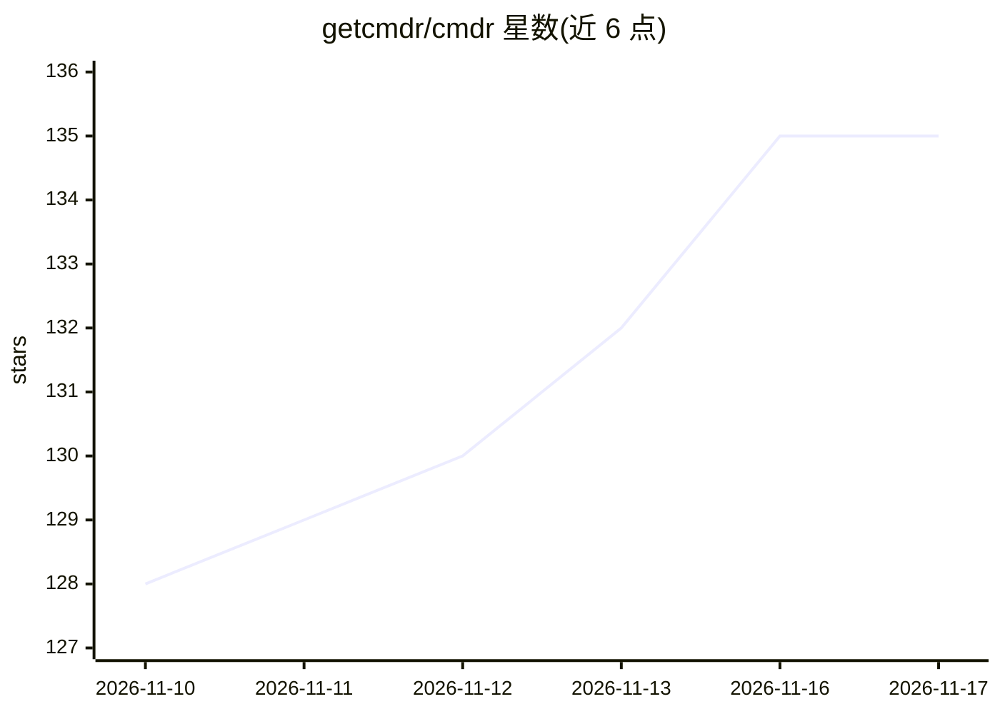

# getcmdr/cmdr

⭐ 135 · Rust · NOASSERTION · 推送 2026-11-16 · [GitHub](https://github.com/getcmdr/cmdr) · [官网](https://getcmdr.com) · 个人维护

**macOS 键盘驱动双栏文件管理器，AI 功能可选**

用 Rust+Tauri 与 Svelte/TypeScript 构建的 macOS 双栏文件管理器，主打键盘优先操作（复制/移动/重命名/删除快捷键）、明暗模式（对比度按 WCAG 2.2 AA 与 APCA 校验）。AI 功能默认关闭且可选开启：自然语言搜索与智能选择，本地与云端 AI 均需 opt-in，关闭 AI 时为类 Total Commander 体验。采用源码可得的 Business Source License 1.1：个人非商业免费，商业需付费许可，源码在发布 3 年后转为 AGPL-3.0。仅支持 macOS，Windows/Linux 未适配。

## 筛选速览

| 维度 | 判定 | 备注 |
|---|---|---|
| AI 角色 | `ai-enhanced` | 去掉 AI 部分产品仍成立 |
| 许可风险 | `none` | NOASSERTION |
| 部署形态 | `None` |  |
| 模型依赖 | — | README 未给出锁定关系 |
| 硬件要求 | — | 无带数字的原话,不猜 |
| 安装摩擦 | `low` | 无编译、无系统依赖或容器化 |
| 成熟度 | — | 结构信号不足 |

## 能力要点

- 双栏布局与全键盘操作（F5 复制/F6 移动等）
- AI 功能默认关闭，本地与云端均 opt-in，隐私优先
- 自然语言搜索与智能选择，智能重命名/自动整理在规划中
- 个人非商业使用免费，商业需一次性付费许可

## 适用场景

- 用键盘高效完成文件复制、移动、重命名与删除
- 从 Total Commander 迁移到 macOS 后延续双栏操作习惯
- 可选开启自然语言搜索与智能选择文件

## 场景标签

 · 领域:桌面工具/文件管理

## 证据(README 行号)

> L28: Then there is AI. With LLMs, some really cool features became possible that never were. I'm experimenting with addi
> L29: these features gradually. But the intention is that AI features remain fully **optional**. With AI features off, yo
> L31: and (human-approved!) auto-organization coming soon. AI features are off by default, and both local and cloud AI ar

## 星数曲线

2026-11-10 128 → 2026-11-17 135（+7）

---
*卡片 v1 · prompt 1.4 · 生成 2026-11-17 · 置信度 high · 依据 README sha `cfb8c30a63f1` · [字段定义](../../DATASET.md)*
