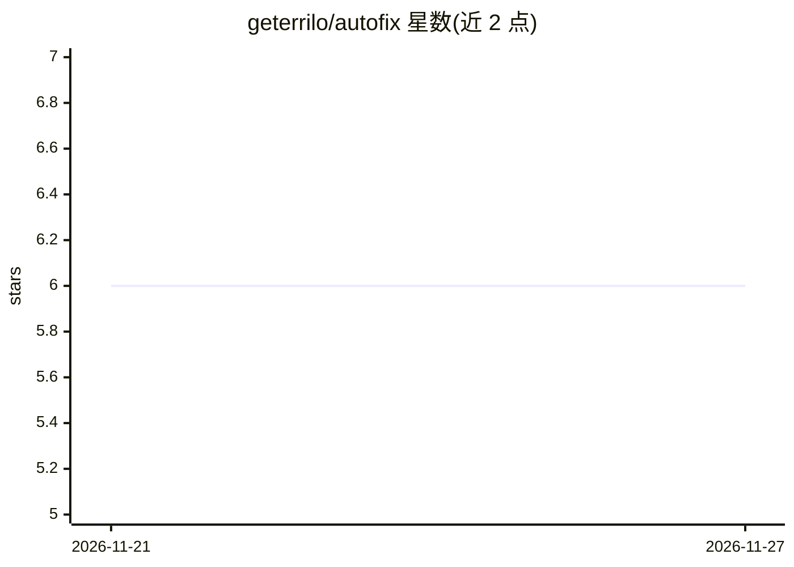

# geterrilo/autofix

⭐ 6 · Shell · MIT · 推送 2026-11-20 · [GitHub](https://github.com/geterrilo/autofix) · [官网](https://www.errilo.com/en/auto-fix/) · 组织维护

**从 GitHub Actions 自动修复线上错误的 AI agent**

一个 GitHub Action：当 Errilo 上报新 issue 或回归时，agent（默认 Claude Code）通过 Errilo MCP server 读取错误，写出失败的测试复现问题并修复，随后自动发起 pull request 并把 issue 标记为“下个版本解决”。工作流拆成 check/fix/pull-request 三个 job，agent 持有的 token 只有读权限，写操作由单独的 pull-request job 完成。agent 使用用户自己的 Anthropic 账号，MCP server 与该 Action 在所有计划下不额外收费。

## 筛选速览

| 维度 | 判定 | 备注 |
|---|---|---|
| AI 角色 | `ai-native` | 本体是模型或模型工具 |
| 许可风险 | `permissive` | MIT |
| 部署形态 | `None` |  |
| 模型依赖 | locked-api |  |
| 硬件要求 | — | 无带数字的原话,不猜 |
| 安装摩擦 | `low` | 无编译、无系统依赖或容器化 |
| 成熟度 | — | 结构信号不足 |

## 能力要点

- issue→失败测试复现→修复→PR 的四步自动流程
- 三 job 分离设计，agent 不持有可写仓库的 token
- agent 运行在用户自己的 Anthropic 账号上，MCP server 与 Action 不额外收费
- 支持替换为其他 agent

## 适用场景

- 生产环境报错后在 GitHub Actions 中自动生成修复 PR
- Errilo 监控到回归时自动复现并修复
- 限制 agent 权限的安全化自动修复流水线

## 场景标签

`编码 Agent` · 领域:编码与开发

## 证据(README 行号)

> L3: Fix production errors with an AI agent, straight from GitHub Actions. When Errilo reports a new issue or a regressio
> L9: One action, four steps, used in three jobs of your workflow so that the agent never holds a token that can write to 

## 星数曲线

2026-11-21 6 → 2026-11-27 6（+0）

---
*卡片 v1 · prompt 1.4 · 生成 2026-11-21 · 置信度 high · 依据 README sha `fb0fa7d720f5` · [字段定义](../../DATASET.md)*
