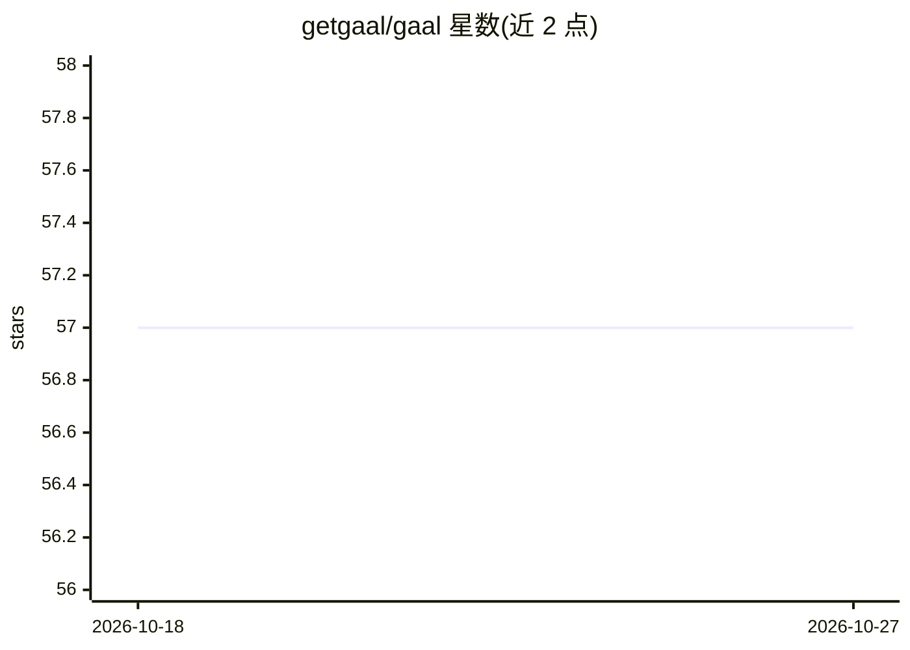

# getgaal/gaal

⭐ 57 · Go · AGPL-3.0 · 推送 2026-08-04 · [GitHub](https://github.com/getgaal/gaal) · [官网](https://getgaal.com) · 组织维护

**用单个 YAML 同步多机多个 AI 编程代理的技能与 MCP 配置的 CLI**

Go 编写的命令行工具，面向同时使用多个 AI 编程代理（Claude Code、Cursor、Codex、GitHub Copilot 等）和多台机器的开发者。核心机制：在一个 gaal.yaml 中声明代码仓库、SKILL.md 技能集合、内容文件（AGENTS.md/CLAUDE.md）与 MCP 服务器条目，执行 gaal sync 时自动检测 17 个代理并写入各自的配置目录；提供 dry-run 预览、status/doctor 健康检查、audit 扫描、后台定时同步、沙箱模式与 JSON Schema 生成。许可为 AGPL-3.0，默认无遥测。

## 筛选速览

| 维度 | 判定 | 备注 |
|---|---|---|
| AI 角色 | `ai-ecosystem` | LLM/agent 周边工具 |
| 许可风险 | `viral` | AGPL-3.0 |
| 部署形态 | `library` | 以包/库形式分发 |
| 模型依赖 | — | README 未给出锁定关系 |
| 硬件要求 | — | 无带数字的原话,不猜 |
| 安装摩擦 | `low` | 无编译、无系统依赖或容器化 |
| 成熟度 | — | 结构信号不足 |

## 能力要点

- 单个 gaal.yaml 统一声明仓库、技能、内容文件与 MCP 服务器
- 自动检测 17 个编程代理并按代理定向分发（支持 ["*"] 通配）
- dry-run 预览、prune 清理孤儿条目、status/doctor 漂移与健康检查
- 可注册自定义代理，支持后台服务模式定时同步

## 适用场景

- 我在多个机器上用多个 AI 编程代理，想统一管理技能和 MCP 配置
- 新装一台机器时快速引导所有代理的技能与 MCP 配置到位
- CI 中用 dry-run 与 JSON 输出校验配置漂移

## 场景标签

 · 领域:AI 代理配置管理/开发者工具

## 证据(README 行号)

> L21: If you use more than one AI coding agent (Claude Code, Cursor, Codex, GitHub Copilot, …) across more than one machi
> L30: 4. **MCP servers**: server entries upserted into each agent's config, leaving the rest of the file untouched

## 星数曲线

2026-10-18 57 → 2026-10-27 57（+0）

---
*卡片 v1 · prompt 1.4 · 生成 2026-10-24 · 置信度 high · 依据 README sha `00855ad99275` · [字段定义](../../DATASET.md)*
