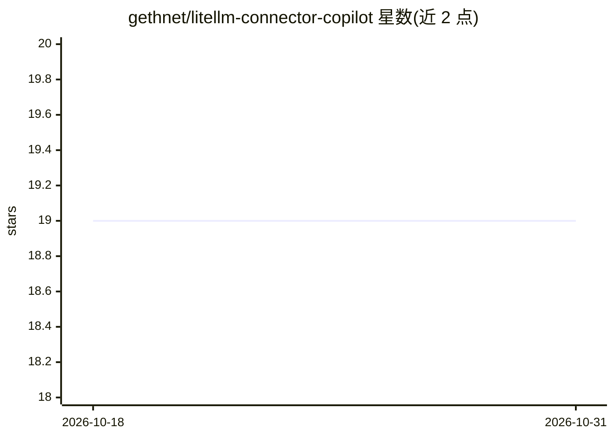

# gethnet/litellm-connector-copilot

⭐ 19 · TypeScript · Apache-2.0 · 推送 2026-10-29 · [GitHub](https://github.com/gethnet/litellm-connector-copilot) · 个人维护

**VS Code 扩展：把 LiteLLM 代理上的多模型接入 Copilot Chat**

VS Code 扩展，将运行中的 LiteLLM 代理注册为 VS Code Language Models provider-group，使 Copilot Chat（及 BYOK 无订阅模式、含离线场景）可选用数百个来自 OpenAI、Anthropic、本地 Llama 等的模型。实现消息格式化、流式输出、工具调用、视觉输入与 token 计数（含按服务器 usage 自校准），支持多后端分组、Git 提交信息生成、模型元数据覆盖。限制：部分 VS Code 界面（Next Edit Suggestions、执行/搜索子代理等）仍仅支持 Copilot 模型；企业策略可禁用 BYOK。单一维护者项目。

## 筛选速览

| 维度 | 判定 | 备注 |
|---|---|---|
| AI 角色 | `ai-ecosystem` | LLM/agent 周边工具 |
| 许可风险 | `permissive` | Apache-2.0 |
| 部署形态 | `None` |  |
| 模型依赖 | — | README 未给出锁定关系 |
| 硬件要求 | — | 无带数字的原话,不猜 |
| 安装摩擦 | `low` | 无编译、无系统依赖或容器化 |
| 成熟度 | — | 结构信号不足 |

## 能力要点

- 将 LiteLLM 代理模型接入 VS Code Copilot Chat，无需 Copilot 订阅即可使用（含离线场景）
- 支持流式输出、工具调用、视觉输入与 Anthropic thinking 元数据
- 多后端聚合，模型按 provider group 命名空间分组
- token 计数按服务器 usage 自校准（×1.0–×2.0 修正因子）

## 适用场景

- 在 Copilot Chat 中使用自选的云端或本地 LLM
- 企业防火墙内使用私有 LLM 进行编码辅助
- 从暂存改动生成规范化 Git 提交信息

## 场景标签

`AI 助手` · 领域:对话与助手

## 证据(README 行号)

> L28: The LiteLLM Connector unlocks **hundreds of models** from **any provider**—OpenAI, Anthropic, Google, Mistral, loca
> L65: > **Configuration flow**: This extension uses VS Code's **Language Models provider-group** flow (VS Code 1.120+) fo

## 星数曲线

2026-10-18 19 → 2026-10-31 19（+0）

---
*卡片 v1 · prompt 1.4 · 生成 2026-10-28 · 置信度 high · 依据 README sha `23180b5b927e` · [字段定义](../../DATASET.md)*
