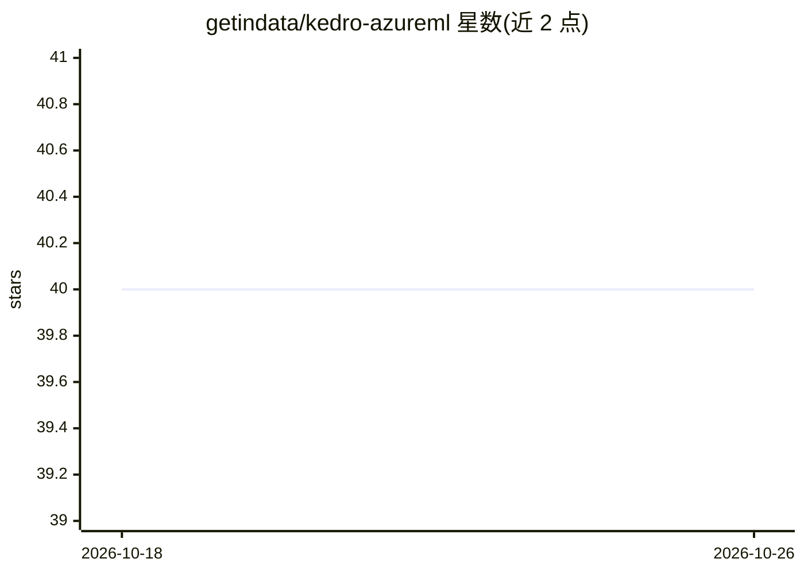

# getindata/kedro-azureml

⭐ 40 · Python · Apache-2.0 · 推送 2025-11-24 · [GitHub](https://github.com/getindata/kedro-azureml) · [官网](https://kedro-azureml.readthedocs.io) · 组织维护

**在 Azure ML Pipelines 上运行 Kedro 工作流的插件**

Kedro 插件，将 Kedro 流水线提交到 Microsoft Azure ML Pipelines 服务运行。支持两类工作流：面向数据科学家的快速迭代开发（代码上传）与面向 MLOps 的基于 Docker 的可重复工作流。通过 kedro azureml 命令行使用，以 Python 包发布于 PyPI，由 GetInData 团队维护并提供 readthedocs 文档与视频教程。

## 筛选速览

| 维度 | 判定 | 备注 |
|---|---|---|
| AI 角色 | `ai-ecosystem` | LLM/agent 周边工具 |
| 许可风险 | `permissive` | Apache-2.0 |
| 部署形态 | `library` | 以包/库形式分发 |
| 模型依赖 | — | README 未给出锁定关系 |
| 硬件要求 | — | 无带数字的原话,不猜 |
| 安装摩擦 | `low` | 无编译、无系统依赖或容器化 |
| 成熟度 | — | 结构信号不足 |

## 能力要点

- 将 Kedro 流水线运行于 Azure ML Pipelines
- 支持代码上传的迭代式开发与 Docker 稳定工作流两种模式
- 提供 kedro azureml CLI 与 readthedocs 文档

## 适用场景

- 把 Kedro 项目部署到 Azure ML 上运行
- 数据科学家快速迭代实验，MLOps 团队构建可重复流水线

## 场景标签

`MLOps` · 领域:训练与推理

## 证据(README 行号)

> L16: Following plugin enables running Kedro pipelines on Azure ML Pipelines service.
> L18: We support 2 native Azure Machine Learning types of workflows:

## 星数曲线

2026-10-18 40 → 2026-10-26 40（+0）

---
*卡片 v1 · prompt 1.4 · 生成 2026-10-25 · 置信度 mid · 依据 README sha `6d0dda642199` · [字段定义](../../DATASET.md)*
