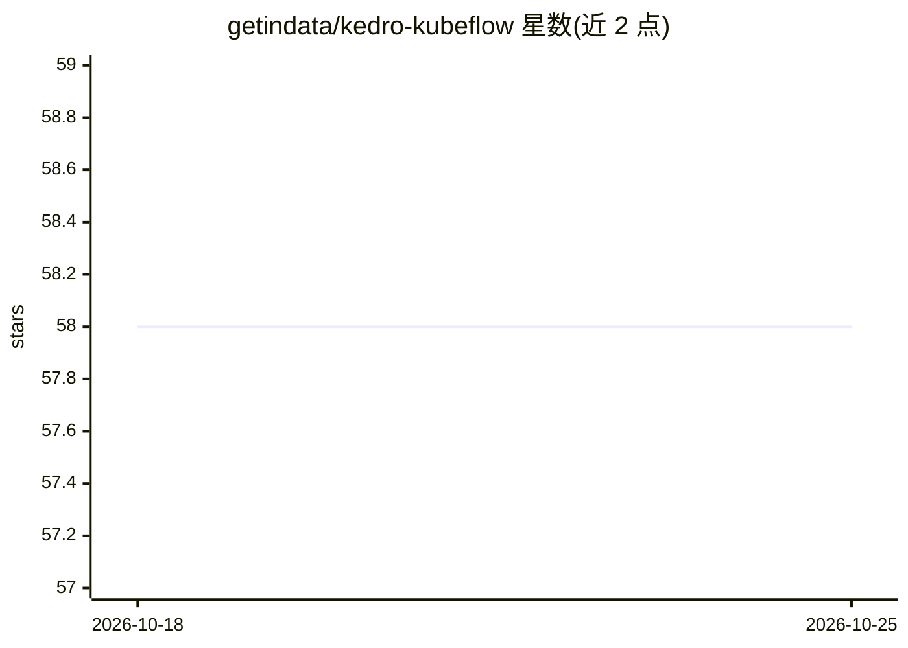

# getindata/kedro-kubeflow

⭐ 58 · Python · Apache-2.0 · 推送 2026-05-29 · [GitHub](https://github.com/getindata/kedro-kubeflow) · [官网](https://kedro-kubeflow.readthedocs.io) · 组织维护

**将 Kedro 工作流翻译并部署到 Kubeflow Pipelines 的插件**

Kedro 插件，把 Kedro pipeline DSL 翻译为 Kubeflow Pipelines SDK（kfp）描述，并通过 CLI 命令部署到运行中的 Kubeflow 集群执行。可与 kedro-docker 配合简化流水线执行所需 docker 镜像的准备。kedro init 会生成插件配置文件，用户可按运行环境调整。面向使用 Kedro 做 ML 工作流的开发者，属于 MLOps 编排工具链。

## 筛选速览

| 维度 | 判定 | 备注 |
|---|---|---|
| AI 角色 | `ai-ecosystem` | LLM/agent 周边工具 |
| 许可风险 | `permissive` | Apache-2.0 |
| 部署形态 | `library` | 以包/库形式分发 |
| 模型依赖 | — | README 未给出锁定关系 |
| 硬件要求 | — | 无带数字的原话,不猜 |
| 安装摩擦 | `low` | 无编译、无系统依赖或容器化 |
| 成熟度 | — | 结构信号不足 |

## 能力要点

- Kedro DSL 到 kfp（Pipelines SDK）的翻译
- CLI 命令部署流水线到 Kubeflow 集群
- 可与 kedro-docker 配合准备执行镜像
- kedro init 自动生成配置文件

## 适用场景

- 把已有的 Kedro 流水线迁移到 Kubeflow Pipelines 运行
- 在 Kubeflow 集群上编排和执行 ML 工作流
- 配合 kedro-docker 打包流水线执行环境

## 场景标签

`MLOps` · 领域:训练与推理

## 证据(README 行号)

> L15: The main purpose of this plugin is to enable running kedro pipeline on Kubeflow Pipelines. It supports translation 
> L16: Kedro pipeline DSL to kfp (pipelines SDK) and deployment to

## 星数曲线

2026-10-18 58 → 2026-10-25 58（+0）

---
*卡片 v1 · prompt 1.4 · 生成 2026-10-24 · 置信度 high · 依据 README sha `20e0e73dcc21` · [字段定义](../../DATASET.md)*
