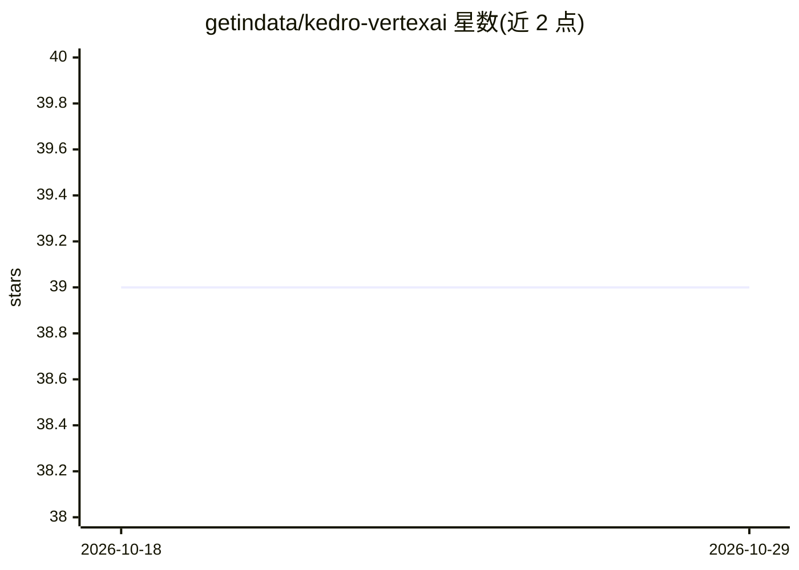

# getindata/kedro-vertexai

⭐ 39 · Python · Apache-2.0 · 推送 2026-10-27 · [GitHub](https://github.com/getindata/kedro-vertexai) · [官网](https://kedro-vertexai.readthedocs.io) · 组织维护

**Kedro 插件：将流水线部署到 GCP Vertex AI Pipelines**

kedro-vertexai 是一个 Kedro 插件，将 Kedro 流水线 DSL 翻译为 Kubeflow Pipelines SDK 表达，并部署到 Google Cloud Platform 的 Vertex AI Pipelines 服务，提供一组 CLI 命令（kedro vertexai ...）用于交互与部署。配置文件由 kedro init 生成，用户可按运行环境调整。可配合 kedro-docker 简化流水线执行镜像的准备工作。面向使用 Kedro 构建 ML 流水线并运行在 GCP 上的 MLOps 工程师。

## 筛选速览

| 维度 | 判定 | 备注 |
|---|---|---|
| AI 角色 | `ai-ecosystem` | LLM/agent 周边工具 |
| 许可风险 | `permissive` | Apache-2.0 |
| 部署形态 | `library` | 以包/库形式分发 |
| 模型依赖 | — | README 未给出锁定关系 |
| 硬件要求 | — | 无带数字的原话,不猜 |
| 安装摩擦 | `low` | 无编译、无系统依赖或容器化 |
| 成熟度 | — | 结构信号不足 |

## 能力要点

- Kedro pipeline DSL 到 kfp（pipelines SDK）的翻译
- 部署到 Vertex AI Pipelines 的 CLI 命令
- kedro init 生成配置文件，可按环境调整
- 可与 kedro-docker 配合准备执行镜像

## 适用场景

- 将 Kedro 流水线迁移到 GCP Vertex AI 上运行
- 通过 CLI 命令与 Vertex AI Pipelines 交互和部署
- 用 kedro-docker 组合准备流水线执行环境

## 场景标签

`MLOps` · 领域:训练与推理

## 证据(README 行号)

> L15: The main purpose of this plugin is to enable running kedro pipeline on Google Cloud Platform - Vertex AI Pipelines.
> L16: It supports translation from Kedro pipeline DSL to kfp
> L17: (pipelines SDK) and deployment to Vertex AI service with some convenient commands.

## 星数曲线

2026-10-18 39 → 2026-10-29 39（+0）

---
*卡片 v1 · prompt 1.4 · 生成 2026-10-25 · 置信度 high · 依据 README sha `e22a9553a83a` · [字段定义](../../DATASET.md)*
