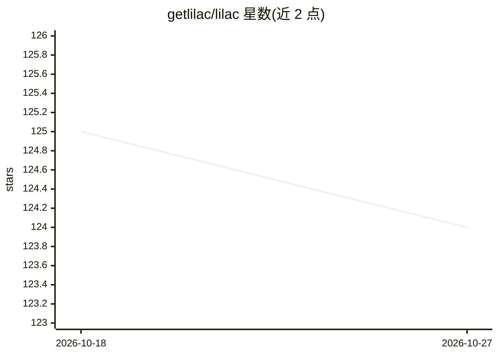

# getlilac/lilac

⭐ 124 · TypeScript · Apache-2.0 · 推送 2026-04-07 · [GitHub](https://github.com/getlilac/lilac) · [官网](https://getlilac.com) · 组织维护

**面向数据科学团队的 GPU 算力聚合与任务调度平台**

Lilac 连接来自本地或云端的任意计算资源，组成统一集群：提供 Web 管理界面、控制平面调度器与运行在各节点的轻量 agent。支持容器化分布式任务执行、基于资源可用性的调度、带优先级的任务队列、实时监控与用户/API Key 管理。安装方式为 macOS/Linux 安装脚本安装 CLI，平台通过 Docker Compose 启动（含本地 PostgreSQL、后端与 Web UI），节点通过 Docker 镜像以 API Key 加入集群。实例池、Jupyter/VSCode 工作区等功能标注为开发中。

## 筛选速览

| 维度 | 判定 | 备注 |
|---|---|---|
| AI 角色 | `ai-ecosystem` | LLM/agent 周边工具 |
| 许可风险 | `permissive` | Apache-2.0 |
| 部署形态 | `self-host` | docker 或自建部署 |
| 模型依赖 | — | README 未给出锁定关系 |
| 硬件要求 | — | 无带数字的原话,不猜 |
| 安装摩擦 | `low` | 无编译、无系统依赖或容器化 |
| 成熟度 | — | 结构信号不足 |

## 能力要点

- 聚合本地与云端任意来源计算资源为统一集群
- 容器化分布式任务执行与基于资源的调度
- Web UI 管理、RESTful API、实时监控与任务队列
- 节点通过 Docker agent 与集群 API Key 接入

## 适用场景

- 把分散的 GPU 服务器组成集群统一调度训练任务
- 团队通过 Web UI 管理队列、节点与任务状态
- 以 CLI 提交容器化作业到集群执行

## 场景标签

`MLOps` · 领域:训练与推理

## 证据(README 行号)

> L12: Lilac ensures your data scientists always have enough GPUs for their work. We seamlessly connect compute from any s
> L81: * **Resource-Based Scheduling**: The scheduler assigns jobs to nodes based on their resource availability and the j

## 星数曲线

2026-10-18 125 → 2026-10-27 124（-1）

---
*卡片 v1 · prompt 1.4 · 生成 2026-10-23 · 置信度 high · 依据 README sha `9756bef19a07` · [字段定义](../../DATASET.md)*
