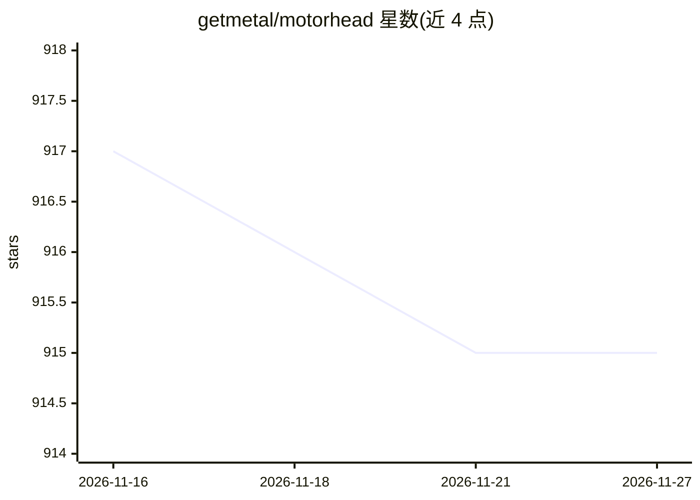

# getmetal/motorhead

⭐ 915 · Rust · Apache-2.0 · 推送 2026-11-24 · [GitHub](https://github.com/getmetal/motorhead) · [官网](https://getmetal.io) · 组织维护

**为 LLM 应用提供记忆与检索的服务端（已停止维护）**

Rust 编写的 LLM 记忆与信息检索服务器：提供 3 个 API 管理会话消息（GET/POST/DELETE），按 MAX_WINDOW_SIZE 窗口截断消息并用 OpenAI 模型（默认 gpt-3.5-turbo）做增量摘要，另支持基于 Redisearch VSS 的文本检索与会话级过滤；可选开启长期记忆。依赖 Redis 与 OpenAI API key，通过 docker-compose 或官方镜像运行。README 声明项目已弃用、不再维护。

## 筛选速览

| 维度 | 判定 | 备注 |
|---|---|---|
| AI 角色 | `ai-ecosystem` | LLM/agent 周边工具 |
| 许可风险 | `permissive` | Apache-2.0 |
| 部署形态 | `self-host` | docker 或自建部署 |
| 模型依赖 | — | README 未给出锁定关系 |
| 硬件要求 | — | 无带数字的原话,不猜 |
| 安装摩擦 | `low` | 无编译、无系统依赖或容器化 |
| 成熟度 | — | 结构信号不足 |

## 能力要点

- 会话消息的存取/删除 API，超出窗口自动增量摘要
- 基于 Redisearch VSS 的文本检索，按会话隔离
- 支持 Azure OpenAI 部署配置
- 提供 JS 与 Python 聊天示例

## 适用场景

- 为聊天应用提供开箱即用的对话记忆管理
- 控制传给 LLM 的上下文窗口长度并自动摘要历史
- 在会话内做语义检索

## 场景标签

`Agent 记忆` `语义搜索` · 领域:Agent 开发

## 证据(README 行号)

> L15: Motorhead is a memory and information retrieval server for LLMs.
> L21: When building chat applications using LLMs, memory handling is something that has to be built every time. Motorhead

## 星数曲线

2026-11-16 917 → 2026-11-27 915（-2）

---
*卡片 v1 · prompt 1.4 · 生成 2026-11-17 · 置信度 high · 依据 README sha `1016ac0df81e` · [字段定义](../../DATASET.md)*
