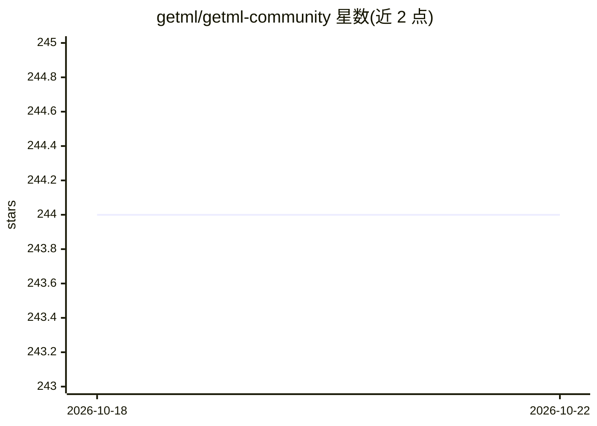

# getml/getml-community

⭐ 244 · C++ · NOASSERTION · 推送 2025-10-27 · [GitHub](https://github.com/getml/getml-community) · [官网](https://getml.com) · 组织维护

**面向关系数据与时间序列的自动特征工程与预测建模工具**

getML 是用于关系型数据和时间序列自动特征工程的 Python 工具，内置专用数据库 Engine，包含 FastProp 算法、预处理器、预测器（线性回归、XGBoost 等）和超参优化器，并可通过 getML Monitor 查看项目、管线与特征信息。自动生成数千个特征并挑选最优。数据源支持 CSV、Pandas、JSON、SQLite、MySQL、PostgreSQL 等。标准版开源但不得用于生产用途，专业版/企业版提供生产使用、训练与部署功能。macOS/Windows 需先启动 Docker 服务。

## 筛选速览

| 维度 | 判定 | 备注 |
|---|---|---|
| AI 角色 | `ai-native` | 本体是模型或模型工具 |
| 许可风险 | `none` | NOASSERTION |
| 部署形态 | `self-host` | docker 或自建部署 |
| 模型依赖 | — | README 未给出锁定关系 |
| 硬件要求 | — | 无带数字的原话,不猜 |
| 安装摩擦 | `low` | 无编译、无系统依赖或容器化 |
| 成熟度 | — | 结构信号不足 |

## 能力要点

- FastProp 算法自动生成并筛选数千个关系/时间序列特征
- 内置预处理器、预测器与超参优化器（含 XGBoost）
- getML Monitor 展示项目、管线、特征与准确性信息
- 支持 CSV/Pandas/JSON/SQLite/MySQL/MariaDB/PostgreSQL 等数据源导入

## 适用场景

- 自动为关系型业务数据构建分类/回归特征
- 时间序列预测中替代手工特征构建
- 通过 Monitor 审查特征重要性与管线表现

## 场景标签

 · 领域:机器学习/数据科学工具

## 证据(README 行号)

> L12: getML is a tool for automating feature engineering on relational data and time series. It includes a specifically c
> L48: The standard version includes preprocessors (like CategoryTrimmer, EmailDomain, Imputation, Mapping, Seasonal, Subs

## 星数曲线

2026-10-18 244 → 2026-10-22 244（+0）

---
*卡片 v1 · prompt 1.4 · 生成 2026-10-22 · 置信度 high · 依据 README sha `dc0e96b14775` · [字段定义](../../DATASET.md)*
