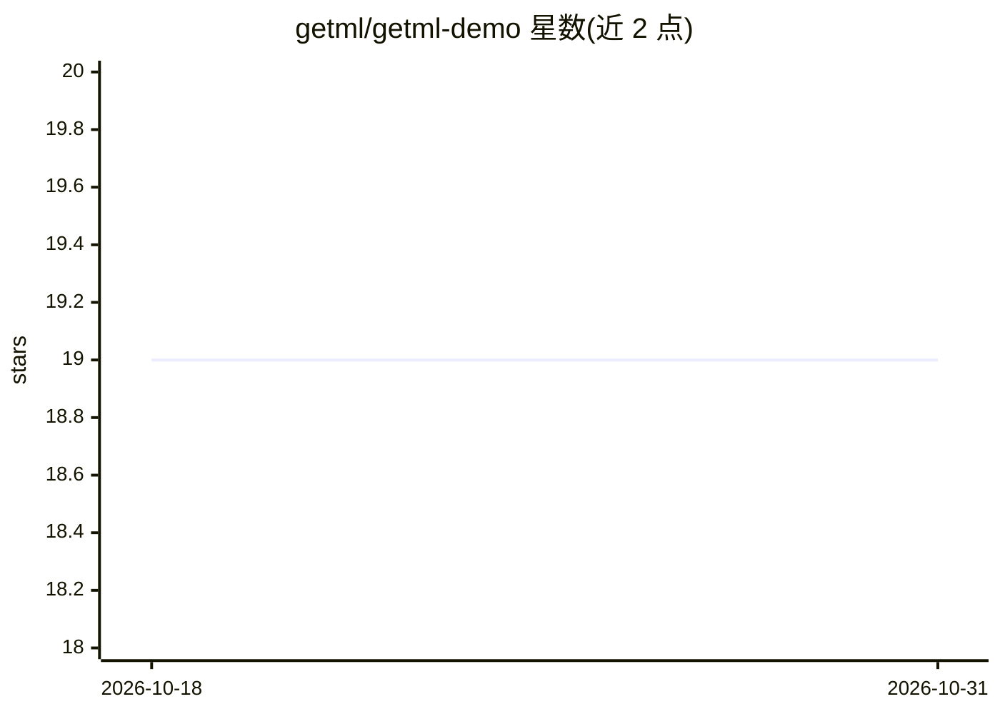

# getml/getml-demo

⭐ 19 · Jupyter Notebook · 推送 2026-01-20 · [GitHub](https://github.com/getml/getml-demo) · [官网](https://github.com/getml/getml-community) · 组织维护

**getML 关系数据机器学习工具的演示 Notebook 集合（17 个项目）**

getML 官方维护的 Jupyter Notebook 展示仓库，覆盖客户流失预测、空气污染回归、疾病致死率分类、球员工资预测等 17 个领域项目，数据规模从 4.6 MB 到 658 MB 不等。Notebook 演示 getML 的特征学习算法（FastProp、Multirel、Relboost、RelMT）、预测器与超参数优化器在公开关系型与时序数据集上的用法，并与 featuretools、tsfresh、prophet 做基准对比。可在线阅读、Docker 运行或在 Linux 本机搭建环境；部分算法属 Enterprise 版，社区版 Engine 不含。

## 筛选速览

| 维度 | 判定 | 备注 |
|---|---|---|
| AI 角色 | `ai-knowledge` | 知识聚合/清单类 |
| 许可风险 | `none` | — |
| 部署形态 | `self-host` | docker 或自建部署 |
| 模型依赖 | — | README 未给出锁定关系 |
| 硬件要求 | — | 无带数字的原话,不猜 |
| 安装摩擦 | `low` | 无编译、无系统依赖或容器化 |
| 成熟度 | — | 结构信号不足 |

## 能力要点

- 17 个跨领域演示项目，覆盖分类与回归、关系型与多变量时序数据
- 演示 FastProp/Multirel/Relboost/RelMT 特征学习算法与多种预测器
- 提供 docker-compose 与 Dockerfile 一键启动 Jupyter Lab
- 部分算法（Multirel/Relboost/RelMT）属 Enterprise 版，可申请试用版

## 适用场景

- 学习 getML 在关系型数据上的特征工程与预测建模
- 按领域或机器学习问题类型挑选项目作为自己方案的蓝图
- 查看 getML 与 featuretools/tsfresh 的基准对比结果

## 场景标签

`教程课程` · 领域:学习与行业

## 证据(README 行号)

> L10: This repository contains different Jupyter Notebooks to demonstrate the capabilities of getML in the realm of machi
> L91: This repository contains various demonstrational projects to help getting started with relational learning and getM

## 星数曲线

2026-10-18 19 → 2026-10-31 19（+0）

---
*卡片 v1 · prompt 1.4 · 生成 2026-10-28 · 置信度 high · 依据 README sha `6a6334c4d60f` · [字段定义](../../DATASET.md)*
