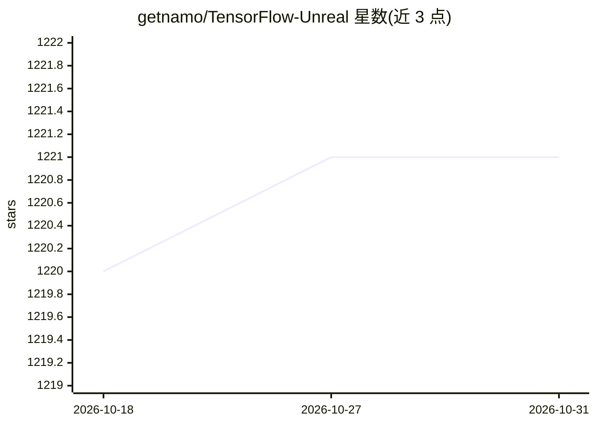

# getnamo/TensorFlow-Unreal

⭐ 1,221 · C++ · NOASSERTION · 推送 2026-10-13 · [GitHub](https://github.com/getnamo/TensorFlow-Unreal) · 个人维护

**在 Unreal Engine 中运行/训练 TensorFlow 模型的插件（蓝图+C++）**

Unreal Engine 5.8 的 TensorFlow/Keras 插件：用户用 Python 编写模型脚本（继承 TFPluginAPI），插件在进程外的嵌入解释器与项目级 venv 中运行、训练模型，通过蓝图组件向脚本送入 JSON、张量、渲染目标与音频输入，并以事件返回结果；训练/推理过程中 Python 崩溃不会带崩编辑器。提供四种环境 profile（tensorflow-cpu 默认、Linux CUDA、Keras 3 on torch 后端、自定义 requirements），打包版可携带解释器与依赖。面向在 UE 中集成 ML 的游戏开发者，已测试 Win64 与 Linux x86_64。

## 筛选速览

| 维度 | 判定 | 备注 |
|---|---|---|
| AI 角色 | `ai-ecosystem` | LLM/agent 周边工具 |
| 许可风险 | `none` | NOASSERTION |
| 部署形态 | `desktop` | 安装包/桌面程序 |
| 模型依赖 | — | README 未给出锁定关系 |
| 硬件要求 | — | 无带数字的原话,不猜 |
| 安装摩擦 | `medium` | 含编译或系统依赖之一 |
| 成熟度 | — | 结构信号不足 |

## 能力要点

- 蓝图与 C++ 双 API：Send Json/Tensor/Texture Input、Begin Training 等节点与 on_json_input 等钩子
- Python 进程外运行（PythonCLI/CLISystem），TensorFlow 崩溃不影响编辑器与游戏线程
- 渲染目标/音频/游戏数据流（Python Render Target Stream 等）逐帧输入模型
- 四种环境 profile，含 Windows GPU 下的 Keras 3 + torch CUDA 后端方案

## 适用场景

- 在 UE 游戏中运行训练好的模型做实时分类/预测
- 用场景捕获或摄像头渲染目标流做实时视觉推理
- 在编辑器内直接训练模型并保存/加载（如 MNIST 示例）

## 场景标签

`推理引擎` · 领域:训练与推理

## 证据(README 行号)

> L8: TensorFlow and Keras for Unreal Engine 5.8, from Blueprints and C++. You write the model in Python. The plugin runs 
> L79: **TensorFlow component.** It is a Python ML component, and runs in PythonCLI's shared Python process by default.

## 星数曲线

2026-10-18 1,220 → 2026-10-31 1,221（+1）

---
*卡片 v1 · prompt 1.4 · 生成 2026-10-21 · 置信度 high · 依据 README sha `b8adae336bab` · [字段定义](../../DATASET.md)*
