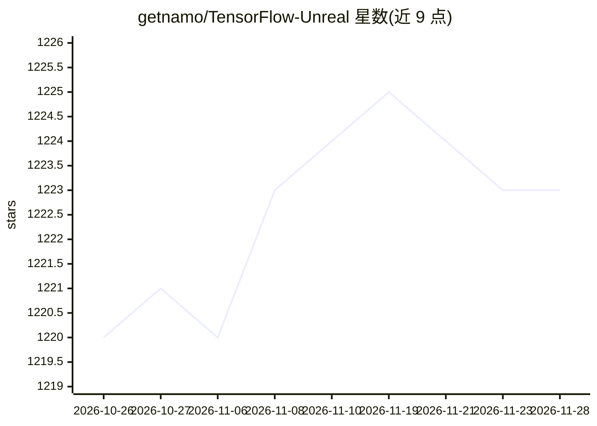

# getnamo/TensorFlow-Unreal

⭐ 1,223 · C++ · NOASSERTION · 推送 2026-11-05 · [GitHub](https://github.com/getnamo/TensorFlow-Unreal) · 个人维护

**为 Unreal Engine 提供 TensorFlow/Keras 的 Blueprint/C++ 接入插件**

面向 Unreal Engine 5.8 的插件：用户在 Python 中编写 TensorFlow/Keras 模型，插件在编辑器或打包游戏中以独立进程的嵌入式解释器运行它，支持训练、推理，并可将输入、渲染目标纹理与音频送入模型，结果与事件回传 Blueprint。2.0 架构改为通过 PythonCLI 管理每项目虚拟环境，崩溃不影响编辑器；1.x 脚本 API 保持兼容，但 TF1 会话脚本需迁移到 TF2/Keras 3。

## 筛选速览

| 维度 | 判定 | 备注 |
|---|---|---|
| AI 角色 | `ai-ecosystem` | LLM/agent 周边工具 |
| 许可风险 | `none` | NOASSERTION |
| 部署形态 | `desktop` | 安装包/桌面程序 |
| 模型依赖 | — | README 未给出锁定关系 |
| 硬件要求 | — | 无带数字的原话,不猜 |
| 安装摩擦 | `medium` | 含编译或系统依赖之一 |
| 成熟度 | — | 结构信号不足 |

## 能力要点

- 独立进程运行 Python，模型崩溃不影响编辑器
- Blueprint 组件提供训练/推理调用与异步节点、自定义事件回传
- 环境 profile 支持 tensorflow-cpu、CUDA(Linux) 与 Keras on PyTorch(Windows GPU)
- 提供纹理/渲染目标/音频/游戏数据流式输入与 MNIST 示例地图

## 适用场景

- 在 Unreal 项目中训练和运行 Keras CNN 并将预测结果接入游戏逻辑
- 把场景捕获的渲染目标逐帧送入 Python 模型做分类
- 打包 Win64/Linux 游戏时随包携带 Python 环境与模型脚本

## 场景标签

 · 领域:游戏开发/机器学习集成

## 证据(README 行号)

> L8: TensorFlow and Keras for Unreal Engine 5.8, from Blueprints and C++. You write the model in Python. The plugin runs 
> L11: - Python runs out of process, in an embedded interpreter with a per-project virtual environment, through PythonCLI 

## 星数曲线

2026-10-26 1,220 → 2026-11-28 1,223（+3）

---
*卡片 v1 · prompt 1.4 · 生成 2026-11-23 · 置信度 high · 依据 README sha `718c6aadda35` · [字段定义](../../DATASET.md)*
