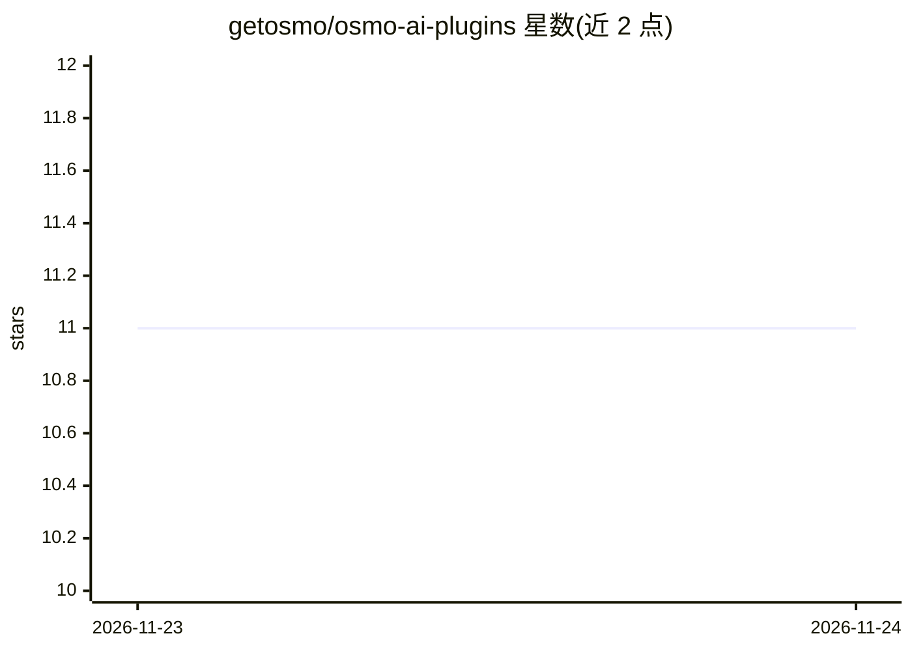

# getosmo/osmo-ai-plugins

⭐ 11 · MIT · 推送 2026-11-21 · [GitHub](https://github.com/getosmo/osmo-ai-plugins) · [官网](https://getosmo.app/for-my-ai) · 组织维护

**让 ChatGPT/Claude 等 AI 客户代打电话并接听的 MCP 服务**

OsmO 是托管式 MCP 服务器（URL api.getosmo.app/mcp），让用户的 AI 应用代拨真实电话：向商店、诊所、餐厅咨询营业时间/库存/预约，返回结果、摘要、录音与转录；同时可作为 AI 电话前台接听来电、过滤骚扰并留言。README 给出 ChatGPT、Claude、Cursor、Codex、Gemini CLI、Grok、Perplexity 等 15+ 客户端的逐步接入配置，并提供 Claude Code/Codex 插件与 OpenClaw 技能包。本机无需安装任何程序，浏览器一次登录即可；免费额度 50 credits，接通电话每通 3 credits，联系人外呼与预约需付费 app 计划。

## 筛选速览

| 维度 | 判定 | 备注 |
|---|---|---|
| AI 角色 | `ai-native` | 本体是模型或模型工具 |
| 许可风险 | `permissive` | MIT |
| 部署形态 | `None` |  |
| 模型依赖 | locked-api |  |
| 硬件要求 | — | 无带数字的原话,不猜 |
| 安装摩擦 | `low` | 无编译、无系统依赖或容器化 |
| 成熟度 | — | 结构信号不足 |

## 能力要点

- 托管 MCP 服务器，本机零安装，27 个工具含 place_call/get_call_status
- 支持最多 5 通并发外呼，每次来电前返回预览需用户确认
- AI 电话前台：接听、过滤骚扰、留言与预约（需 app 计划）
- 语音 AI 支持 English/Spanish/Hindi，Claude/ChatGPT 显示实时通话卡片

## 适用场景

- 让 AI 打电话问药店营业时间或查库存
- 打电话改约牙医预约、订餐厅桌位
- 用 AI 前台代接来电并过滤骚扰电话

## 场景标签

`语音 Agent` · 领域:对话与助手

## 证据(README 行号)

> L5:  Let your AI make real phone calls for you.
> L65: There is nothing to install or run on your machine. Your AI app connects to OsmO's hosted MCP server.
> L70: Every app uses the same server URL: **`https://api.getosmo.app/mcp`** (Streamable HTTP, OAuth).

## 星数曲线

2026-11-23 11 → 2026-11-24 11（+0）

---
*卡片 v1 · prompt 1.4 · 生成 2026-11-23 · 置信度 high · 依据 README sha `7db16fea2874` · [字段定义](../../DATASET.md)*
