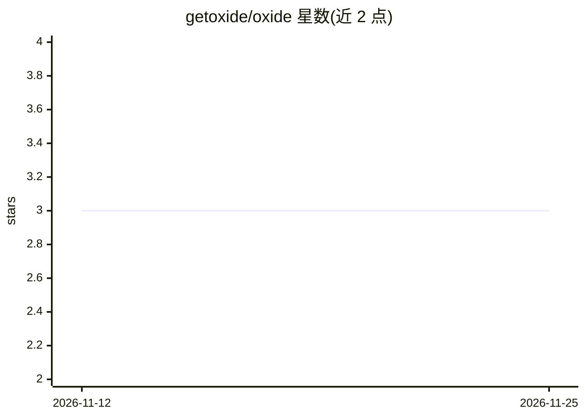

# getoxide/oxide

⭐ 3 · TypeScript · MIT · 推送 2026-11-23 · [GitHub](https://github.com/getoxide/oxide) · [官网](https://oxide.cavallinilorenzo.com) · 组织维护

**面向 GitHub Project 的桌面终端，可在其中运行 AI 编码 CLI**

基于 Rust 与 Tauri 2 的开源桌面终端应用：按 GitHub Project 组织多个纯 shell 终端，内置 GitHub Issues / PR 操作（经 GitHub CLI）、文件浏览与 Monaco 编辑器（带 Rust/TS/Python/C++ 语言服务器）。终端为普通 shell，应用不解释其内容；要使用编码代理需自行输入 claude、codex 等命令，Oxide 不加任何封装、不涉 API key 与遥测。提供 macOS/Windows/Linux 安装包，首次稳定版发布前需从源码构建。

## 筛选速览

| 维度 | 判定 | 备注 |
|---|---|---|
| AI 角色 | `ai-enhanced` | 去掉 AI 部分产品仍成立 |
| 许可风险 | `permissive` | MIT |
| 部署形态 | `desktop` | 安装包/桌面程序 |
| 模型依赖 | — | README 未给出锁定关系 |
| 硬件要求 | — | 无带数字的原话,不猜 |
| 安装摩擦 | `medium` | 含编译或系统依赖之一 |
| 成熟度 | `idea` | |

## 能力要点

- 按 Project 管理多终端，保留各自 scrollback、工作目录与运行进程
- 命令分组为命令/输出/退出状态块
- 内置 GitHub Issues 与 PR 列表/创建/审查/合并（经 gh）
- Monaco 编辑器按需安装语言服务器，WebView 无文件系统与 shell 权限

## 适用场景

- 在一个窗口里同时跑编码代理、服务器与测试监视器
- 边用终端边查看和操作项目的 GitHub Issues 与 PR
- 浏览项目文件并在内置编辑器中修改代码

## 场景标签

 · 领域:开发者工具/桌面终端

## 证据(README 行号)

> L23: Oxide is a free, open-source desktop terminal app that knows your GitHub Projects: open a Project, open as many cle
> L25: Oxide does not know about agents. A terminal is a plain shell that Oxide does not interpret, so if you want an agen
> L190: Oxide is not a coding agent and does not drive one: a terminal is a plain shell. Oxide is not affiliated with Oxid

## 星数曲线

2026-11-12 3 → 2026-11-25 3（+0）

---
*卡片 v1 · prompt 1.4 · 生成 2026-11-22 · 置信度 high · 依据 README sha `289fd22376be` · [字段定义](../../DATASET.md)*
