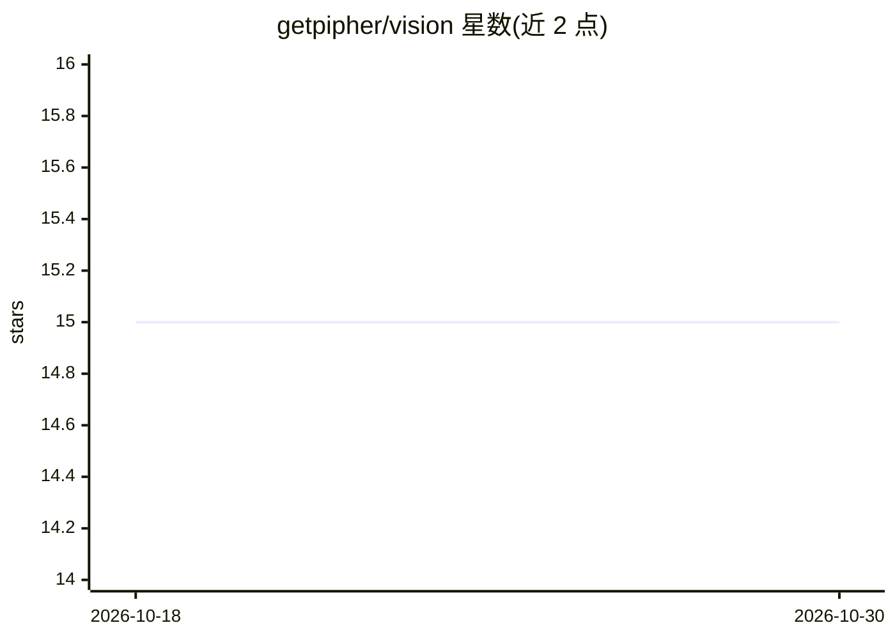

# getpipher/vision

⭐ 15 · TypeScript · MIT · 推送 2026-09-02 · [GitHub](https://github.com/getpipher/vision) · 个人维护

**pi 编码 agent 的能力感知视觉扩展：按模型模态决定是否委托图像分析**

面向 pi 编码 agent 的 TypeScript 扩展包，添加 describe_image 工具与粘贴图像处理：主模型为多模态时图像原样附给模型、工具隐藏不触发调用；主模型为纯文本时委托给配置的视觉模型返回文字描述。附加能力包括内容寻址缓存、指数退避重试与后备模型、图像路径 [Image-#N] 标记、终端内图像预览（Kitty/iTerm2 协议）、单次最多 50 张的批量并行分析、只读模式（图像字节不出本机）以及记录每次委托去向的 JSONL 审计日志。通过 pi install 安装，/vision 命令配置。

## 筛选速览

| 维度 | 判定 | 备注 |
|---|---|---|
| AI 角色 | `ai-ecosystem` | LLM/agent 周边工具 |
| 许可风险 | `permissive` | MIT |
| 部署形态 | `None` |  |
| 模型依赖 | local-ok | 支持本地模型 |
| 硬件要求 | — | 无带数字的原话,不猜 |
| 安装摩擦 | `low` | 无编译、无系统依赖或容器化 |
| 成熟度 | — | 结构信号不足 |

## 能力要点

- 按主模型输入模态自动选择原生附带或委托视觉模型，多模态时零委托调用
- 缓存（内容寻址）、重试、后备视觉模型与批量并行分析（上限 50 张/次）
- local-only 模式下图像字节不出本机
- 每次视觉委托写入 append-only JSONL 审计日志

## 适用场景

- 在 pi 编码 agent 中使用纯文本主模型时分析/对比多张截图
- 多模态主模型下粘贴图像避免重复的视觉模型调用
- 需要审计图像被发送到哪个模型的合规场景

## 场景标签

`图像视频处理` · 领域:感知与多模态

## 证据(README 行号)

> L5: `@getpipher/vision` adds a `describe_image` tool to pi that is **aware of the
> L25: - **Text-only primary model** → `describe_image` delegates to a configured

## 星数曲线

2026-10-18 15 → 2026-10-30 15（+0）

---
*卡片 v1 · prompt 1.4 · 生成 2026-10-30 · 置信度 high · 依据 README sha `bb6bcc66f174` · [字段定义](../../DATASET.md)*
