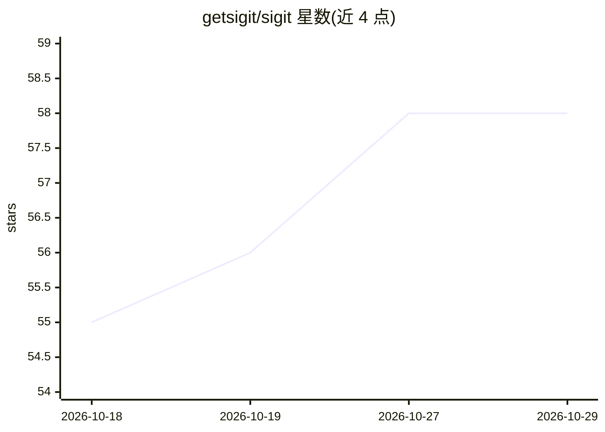

# getsigit/sigit

⭐ 58 · Rust · NOASSERTION · 推送 2026-10-28 · [GitHub](https://github.com/getsigit/sigit) · [官网](https://zed.dev/acp/agent/sigit) · 组织维护

**本地优先的设备端 LLM 编程代理，可接入编辑器或终端使用**

siGit Code 是运行在本机的 AI 编程代理，是 siGit Factory 的代理运行时。默认走设备端推理：首次启动从 Hugging Face 下载约 1-2 GB 的 GGUF 模型，无需 API key，也可选云端推理。支持两种使用方式：通过 Agent Client Protocol v1 由 Zed、Xcode、VS Code 等编辑器经 stdio 启动（--acp），或在终端运行交互式聊天 UI（仅 macOS/Linux）。另提供 sigit run 的 headless/CI 模式，输出 JSONL 事件流。构建时若嵌入凭据会向 Onde 上报模型计时遥测，可用 ONDE_DISABLE_PULSE=1 关闭。

## 筛选速览

| 维度 | 判定 | 备注 |
|---|---|---|
| AI 角色 | `ai-native` | 本体是模型或模型工具 |
| 许可风险 | `none` | NOASSERTION |
| 部署形态 | `desktop` | 安装包/桌面程序 |
| 模型依赖 | local-ok | 支持本地模型 |
| 硬件要求 | — | 无带数字的原话,不猜 |
| 安装摩擦 | `medium` | 含编译或系统依赖之一 |
| 成熟度 | — | 结构信号不足 |

## 能力要点

- 设备端 GGUF 模型推理，无需 API key 即可启动
- 完整实现 Agent Client Protocol v1（会话/权限/MCP/认证等）
- sigit run headless 模式输出 JSONL 事件，带可恢复的持久会话 ID
- 覆盖 macOS/Linux/Windows 三平台（Windows 暂无终端模式）

## 适用场景

- 在 Zed/Xcode/VS Code 中通过 ACP 使用本地编程代理
- 在终端以聊天 UI 完成编码任务
- 在 CI 或脚本中无人值守执行代码审查与测试

## 场景标签

`编码 Agent` `代码审查` · 领域:编码与开发

## 证据(README 行号)

> L9: siGit Code is a local-first AI coding agent. It runs on your machine by default, with optional
> L55: The first launch downloads a GGUF model from Hugging Face. Expect roughly 1 to 2 GB, depending on the model. After 

## 星数曲线

2026-10-18 55 → 2026-10-29 58（+3）

---
*卡片 v1 · prompt 1.4 · 生成 2026-10-24 · 置信度 high · 依据 README sha `9eb667d4875e` · [字段定义](../../DATASET.md)*
