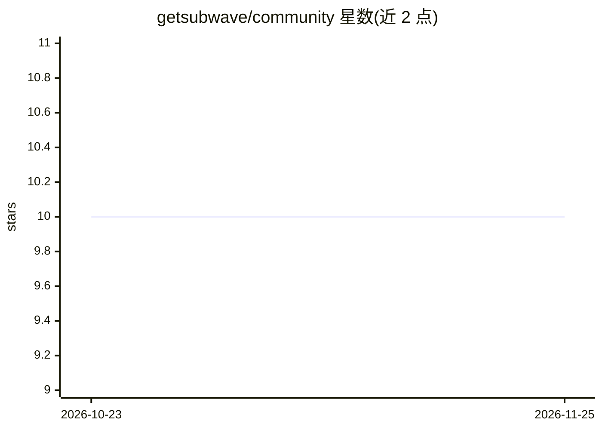

# getsubwave/community

⭐ 10 · JavaScript · 推送 2026-11-23 · [GitHub](https://github.com/getsubwave/community) · [官网](https://www.getsubwave.com/skills) · 组织维护

**SUB/WAVE AI 电台社区目录：技能、人设、节目与电台索引**

SUB/WAVE（带 AI DJ 的个人网络电台）的社区内容仓库，收录五类条目：技能（曲目间的播报简报）、DJ 人设、节目模板、公开电台地图与第三方应用目录。CI 任务在每次推送 main 时把所有条目编译为单个 catalog.json，各运行中的电台按 ~30 分钟 TTL 拉取并缓存，拉取失败时降级为空目录以保持播音不中断；运营者可通过环境变量指向 fork、自建镜像或 jsDelivr CDN。

## 筛选速览

| 维度 | 判定 | 备注 |
|---|---|---|
| AI 角色 | `ai-knowledge` | 知识聚合/清单类 |
| 许可风险 | `none` | — |
| 部署形态 | `None` |  |
| 模型依赖 | — | README 未给出锁定关系 |
| 硬件要求 | — | 无带数字的原话,不猜 |
| 安装摩擦 | `low` | 无编译、无系统依赖或容器化 |
| 成熟度 | — | 结构信号不足 |

## 能力要点

- 五类社区条目：技能、DJ 人设、节目模板、电台地图、应用目录
- CI 自动编译全部条目为单个 catalog.json
- 电台控制器缓存目录并支持空目录降级
- 支持经 COMMUNITY_CATALOG_URL 切换 fork/镜像/CDN 来源

## 适用场景

- 为自己的 SUB/WAVE 电台安装社区贡献的 DJ 技能与人设
- 把运营中的电台登记到公开电台目录
- 为 SUB/WAVE 构建第三方应用并收录到应用目录

## 场景标签

`精选清单` · 领域:学习与行业

## 证据(README 行号)

> L4: personal internet radio station with an AI DJ. This repo holds the community-contributed
> L14: |`skills/`|Between-track segment briefs (prompt-only, data-only)|a DJ skill in `/admin/skills` → Community|
> L27: A CI job (`build-catalog.yml`) compiles every entry into a

## 星数曲线

2026-10-23 10 → 2026-11-25 10（+0）

---
*卡片 v1 · prompt 1.4 · 生成 2026-11-19 · 置信度 high · 依据 README sha `9c514dc90189` · [字段定义](../../DATASET.md)*
