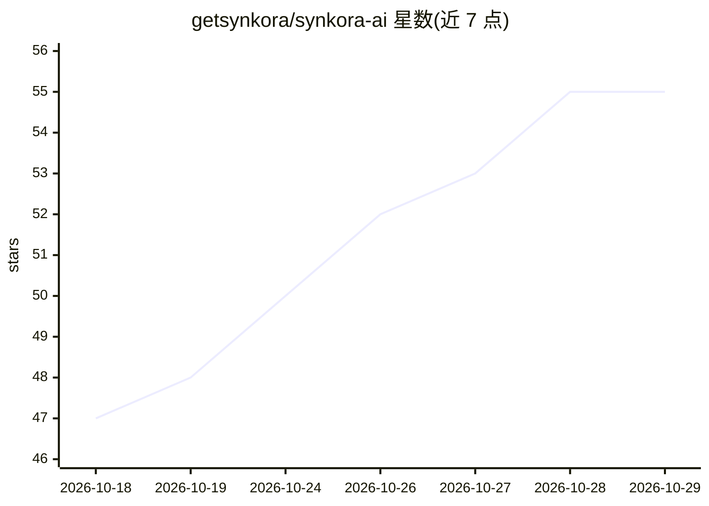

# getsynkora/synkora-ai

⭐ 55 · Python · MIT · 推送 2026-10-24 · [GitHub](https://github.com/getsynkora/synkora-ai) · [官网](https://synkora.ai) · 组织维护

**自托管 AI agent 平台：构建、部署、管理多渠道团队 agent**

面向团队的自托管 AI agent 平台：通过 Web UI 或 REST API 创建 agent，接入 Slack、WhatsApp、Teams、Telegram、网页挂件与 REST API 部署；内置多租户工作区、RAG 知识库（Qdrant/Pinecone/Elasticsearch）、50+ 工具集成、定时任务、HITL 审批、计费与 LLM 成本追踪。LLM 接入经 LiteLLM 支持 OpenAI、Anthropic、Google 等，使用自己的 API key。后端 FastAPI（Python 3.11+），前端 Next.js 15，依赖 PostgreSQL、Redis，Docker Compose 部署并附 Helm charts。MIT 许可。

## 筛选速览

| 维度 | 判定 | 备注 |
|---|---|---|
| AI 角色 | `ai-ecosystem` | LLM/agent 周边工具 |
| 许可风险 | `permissive` | MIT |
| 部署形态 | `self-host` | docker 或自建部署 |
| 模型依赖 | locked-api |  |
| 硬件要求 | — | 无带数字的原话,不猜 |
| 安装摩擦 | `low` | 无编译、无系统依赖或容器化 |
| 成熟度 | — | 结构信号不足 |

## 能力要点

- 多渠道部署：Slack/WhatsApp/Teams/Telegram/网页挂件/REST API 统一平台
- 经 LiteLLM 的多 Provider LLM 接入，使用自有 key
- RAG 知识库与 50+ 预置工具集成、MCP server 支持
- LLM 成本优化：Anthropic prompt caching、Redis 响应缓存、cost-opt 路由、Batch API

## 适用场景

- 搭建 24/7 客服 agent 并在人工介入时升级
- 为工程/营销/数据团队部署内部 copilot 接入现有工具
- 在自有服务器上多租户运营 agent 并按订阅计费

## 场景标签

`Agent 框架` · 领域:Agent 开发

## 证据(README 行号)

> L28: Web UI, multi-tenant workspaces, RAG knowledge bases, 50+ tool integrations, multi-channel deployment, billing, sch
> L43: - **Platform, not a framework** — No infrastructure code to write. Deploy agents from a web UI or REST API in minut

## 星数曲线

2026-10-18 47 → 2026-10-29 55（+8）

---
*卡片 v1 · prompt 1.4 · 生成 2026-10-24 · 置信度 mid · 依据 README sha `5b79a93754e6` · [字段定义](../../DATASET.md)*
