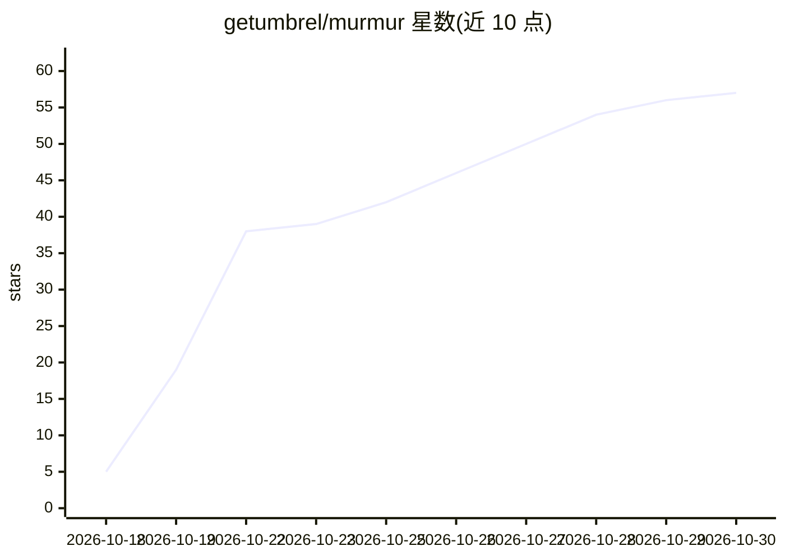

# getumbrel/murmur

⭐ 57 · TypeScript · MIT · 推送 2026-10-29 · [GitHub](https://github.com/getumbrel/murmur) · 组织维护

**自托管 Hermes AI agent 的多端聊天界面与客户端**

Umbrel 团队开发的 Hermes Agent 前端应用：用户创建带个性的 agent（Buddy），通过浏览器、桌面应用（macOS/Windows/Linux）、手机、WhatsApp 和 Telegram 与单个或多个 agent 对话，agent 的记忆与会话数据保存在 Hermes 中，Murmur 读写同一份数据。可连接 ChatGPT 账号或本地模型，也支持 Ollama、OpenRouter、OpenAI、Anthropic 等。安装途径包括 Umbrel 应用商店、桌面安装包和 Docker，附带 Hermes 0.22.0，兼容 0.21.4 以上版本。

## 筛选速览

| 维度 | 判定 | 备注 |
|---|---|---|
| AI 角色 | `ai-ecosystem` | LLM/agent 周边工具 |
| 许可风险 | `permissive` | MIT |
| 部署形态 | `self-host` | docker 或自建部署 |
| 模型依赖 | local-ok | 支持本地模型 |
| 硬件要求 | — | 无带数字的原话,不猜 |
| 安装摩擦 | `low` | 无编译、无系统依赖或容器化 |
| 成熟度 | — | 结构信号不足 |

## 能力要点

- 浏览器/桌面/手机/WhatsApp/Telegram 多端访问同一组 agent
- 支持群聊、@指定 agent、任务审批与计划展示
- 可连接本地模型（Ollama、Umbrel 上运行的模型）或 OpenRouter/OpenAI/Anthropic 等 API
- 自带 Hermes 运行或对接网络中已有的 Hermes 实例

## 适用场景

- 在家里自托管的服务器上运行自己的 AI agent 并随时随地聊天
- 给家人或自己创建多个有分工的 agent 并通过 WhatsApp/Telegram 联系
- 在 Umbrel 上本地运行模型，不依赖云端对话服务

## 场景标签

`聊天机器人` `AI 助手` · 领域:对话与助手

## 证据(README 行号)

> L22: Murmur is the app for Hermes Agent, the open-source agent that runs on your own hardware, remembers what matters, u
> L134: - **Hermes does the work.** Agents are Hermes profiles and chats are Hermes sessions. Murmur reads and writes the 
> L135: - **Hermes comes along.** On umbrelOS and with Docker Compose, Murmur runs its own Hermes right beside it, private

## 星数曲线

2026-10-18 5 → 2026-10-30 57（+52）

---
*卡片 v1 · prompt 1.4 · 生成 2026-10-25 · 置信度 high · 依据 README sha `9d9d16525dd5` · [字段定义](../../DATASET.md)*
