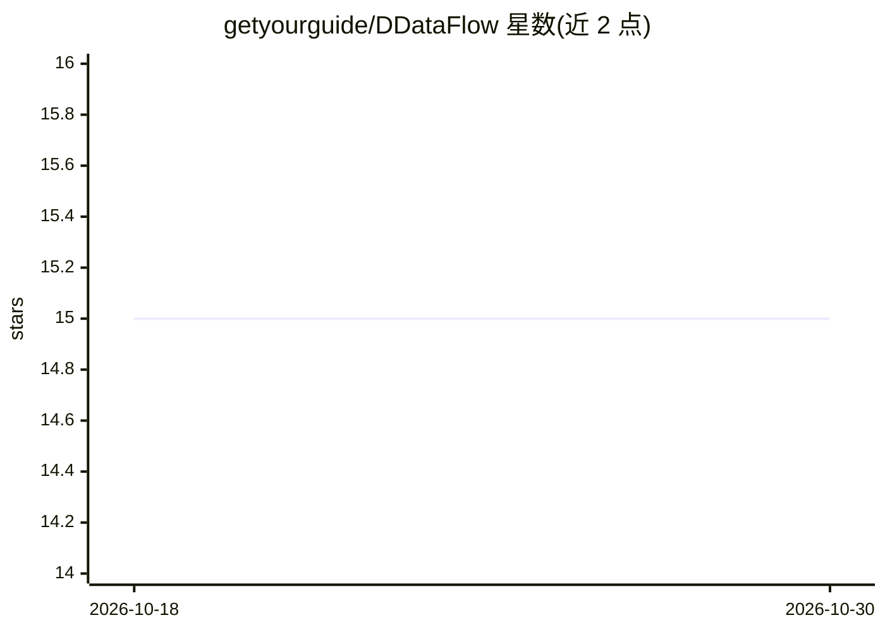

# getyourguide/DDataFlow

⭐ 15 · HTML · Apache-2.0 · 推送 2026-10-26 · [GitHub](https://github.com/getyourguide/DDataFlow) · [官网](https://code.getyourguide.com/DDataFlow/) · 组织维护

**PySpark ML 数据管道的端到端测试与本地开发采样工具**

面向使用 PySpark 的机器学习与数据管道团队：通过读取数据子集加速测试运行，将产物写入测试位置避免污染生产环境，并支持下载数据用于本地机器开发，可在 CI 中运行管道。核心机制是以 ddataflow.source()/name() 替换 spark.table 引用，通过 ENABLE_DDATAFLOW 开关在采样数据与全量数据间切换；提供离线模式，无需活动集群即可测试管道，也可配合 Databricks Connect 使用（README 提到该方式内存问题常见并有覆盖生产数据风险）。以 pip 安装的 Python 包形式提供，附带 CLI 与示例。

## 筛选速览

| 维度 | 判定 | 备注 |
|---|---|---|
| AI 角色 | `ai-ecosystem` | LLM/agent 周边工具 |
| 许可风险 | `permissive` | Apache-2.0 |
| 部署形态 | `library` | 以包/库形式分发 |
| 模型依赖 | — | README 未给出锁定关系 |
| 硬件要求 | — | 无带数字的原话,不猜 |
| 安装摩擦 | `low` | 无编译、无系统依赖或容器化 |
| 成熟度 | — | 结构信号不足 |

## 能力要点

- 读取数据子集加速管道测试运行
- 测试产物写入独立位置，避免污染生产
- 支持下载数据用于本地开发，可在 CI 中运行
- 离线模式无需活动集群即可测试管道

## 适用场景

- 给 PySpark 数据管道跑端到端测试而不动生产数据
- 在本地机器上开发和调试 Spark 管道
- CI 中以采样数据快速运行管道

## 场景标签

`MLOps` · 领域:训练与推理

## 证据(README 行号)

> L3: DDataFlow is an end2end tests and local development solution for machine learning and data pipelines using pyspark.
> L65: The recommended approach to use ddataflow is to use the offline mode, which allows you to test your pipelines witho

## 星数曲线

2026-10-18 15 → 2026-10-30 15（+0）

---
*卡片 v1 · prompt 1.4 · 生成 2026-10-30 · 置信度 high · 依据 README sha `8df21faabfb3` · [字段定义](../../DATASET.md)*
