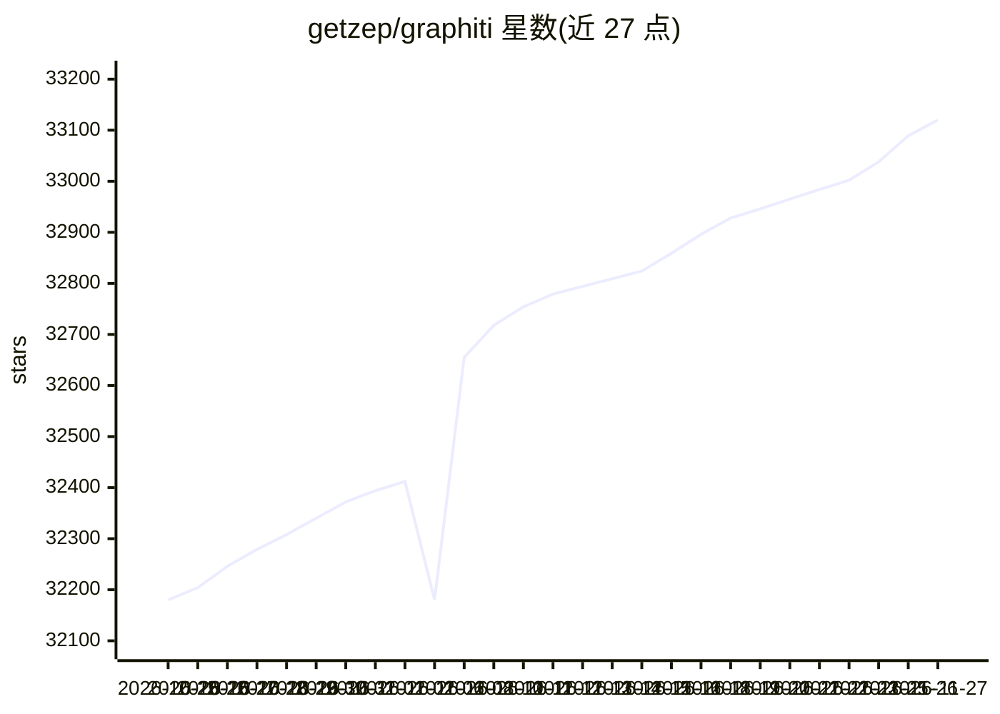

# getzep/graphiti

⭐ 33,120 · Python · Apache-2.0 · 推送 2026-11-26 · [GitHub](https://github.com/getzep/graphiti) · [官网](https://help.getzep.com/graphiti) · 组织维护

**为 AI Agent 构建和查询时序知识图谱的 Python 框架**

开源 Python 框架，用于构建和查询面向 AI Agent 的时序上下文图谱：事实带时间有效期窗口、可溯源至原始数据（episodes），支持通过 Pydantic 模型规定或从数据中学习 ontology，增量更新无需整图重算，检索融合语义嵌入、BM25 关键词与图遍历。用户需自备图数据库（Neo4j/FalkorDB/Amazon Neptune/Relate）、LLM 与嵌入器；默认使用 OpenAI 并需设置 API key，默认低并发以规避 LLM 429 限流。与商业产品 Zep（托管企业上下文层）为不同定位，Graphiti 仅自托管。

## 筛选速览

| 维度 | 判定 | 备注 |
|---|---|---|
| AI 角色 | `ai-ecosystem` | LLM/agent 周边工具 |
| 许可风险 | `permissive` | Apache-2.0 |
| 部署形态 | `self-host` | docker 或自建部署 |
| 模型依赖 | locked-api |  |
| 硬件要求 | — | 无带数字的原话,不猜 |
| 安装摩擦 | `low` | 无编译、无系统依赖或容器化 |
| 成熟度 | — | 结构信号不足 |

## 动量与使用信号

- 维护:`active` — 距上次 push 0.6 天,年发版 38,64 位贡献者
- 涨星:近 1 天 **+80**(自 20261016 起算)
- 安装:pypi 包 `graphiti-core` 月下载 619,128
- 平台:WINDOWS · 协议:OPENAI-API / MCP / OLLAMA

## 能力要点

- 事实带时间有效期窗口，信息变更时旧事实自动失效并保留历史
- episodes 溯源机制：每个事实可回溯到产生它的原始数据
- 混合检索：语义嵌入 + BM25 关键词 + 图遍历
- 通过 Pydantic 模型自定义实体与边类型

## 适用场景

- 为 Agent 搭建随交互演化的记忆知识图谱
- 对频繁变化的企业数据做实时增量入图与历史查询
- 替代平铺文档切片，为应用提供结构化上下文

## 场景标签

`知识图谱` `RAG` `Agent 记忆` · 领域:Agent 开发

## 证据(README 行号)

> L27: Graphiti is a framework for building and querying temporal context graphs for AI agents. Unlike static knowledge gr
> L69: Graphiti is an open-source Python framework for building and querying temporal context graphs. You supply the graph
> L91: |**Graph database**|Konig, Zep's graph database service, built for millions of context graphs with low-latency retr

## 星数曲线

2026-10-25 32,180 → 2026-11-27 33,120（+940）

---
*卡片 v1 · prompt 1.4 · 生成 2026-11-24 · 置信度 high · 依据 README sha `e886600926dd` · [字段定义](../../DATASET.md)*
