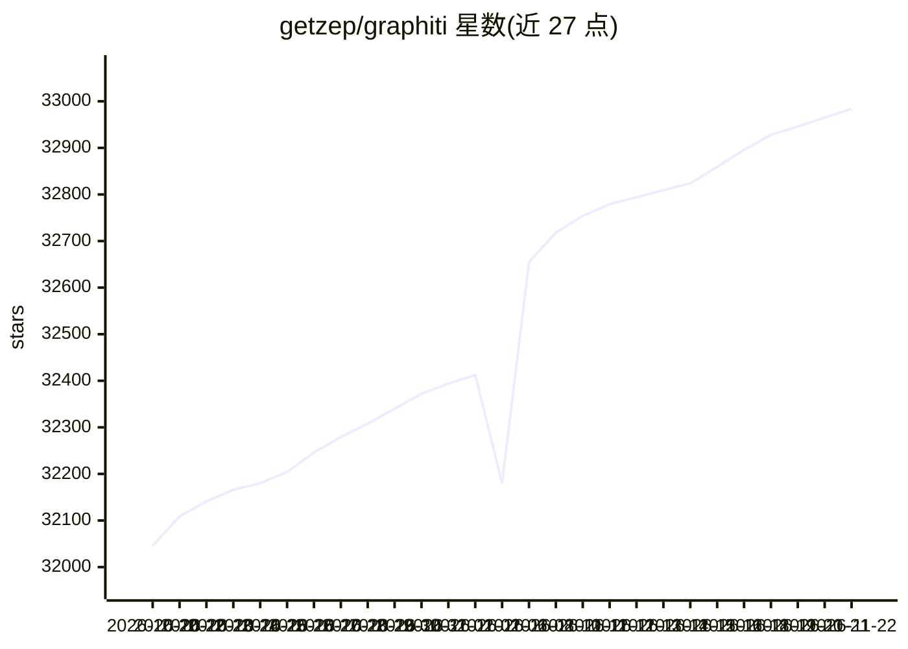

# getzep/graphiti

⭐ 32,984 · Python · Apache-2.0 · 推送 2026-11-20 · [GitHub](https://github.com/getzep/graphiti) · [官网](https://help.getzep.com/graphiti) · 组织维护

**为 AI Agent 构建可查询时序知识图谱的 Python 框架**

Graphiti 是一个开源 Python 框架，用于构建和查询面向 AI Agent 的时序 context graph：事实带有效期窗口、保留对原始数据（episodes）的溯源、支持 Pydantic 定义或从数据中习得的本体。数据增量接入无需全图重算，检索混合语义嵌入、BM25 与图遍历。用户提供图数据库（Neo4j/FalkorDB/Neptune）、LLM 与嵌入器；默认使用 OpenAI，需 OpenAI API key；附参考 MCP 与 REST 服务器实现（无鉴权，非生产部署）。

## 筛选速览

| 维度 | 判定 | 备注 |
|---|---|---|
| AI 角色 | `ai-ecosystem` | LLM/agent 周边工具 |
| 许可风险 | `permissive` | Apache-2.0 |
| 部署形态 | `self-host` | docker 或自建部署 |
| 模型依赖 | local-ok | 支持本地模型 |
| 硬件要求 | — | 无带数字的原话,不猜 |
| 安装摩擦 | `low` | 无编译、无系统依赖或容器化 |
| 成熟度 | — | 结构信号不足 |

## 动量与使用信号

- 维护:`active` — 距上次 push 0.6 天,年发版 38,64 位贡献者
- 涨星:近 1 天 **+80**(自 20261016 起算)
- 安装:pypi 包 `graphiti-core` 月下载 619,128
- 平台:WINDOWS · 协议:OPENAI-API / MCP / OLLAMA

## 能力要点

- 事实带时序有效期窗口，信息变更时旧事实失效而非删除
- 混合检索：语义嵌入 + BM25 关键词 + 图遍历
- 增量图构建，无需批量重算；支持 prescribed/learned 双本体
- 提供参考 MCP 服务器与 REST 服务器实现

## 适用场景

- 给 Agent 构建随交互演化的长期记忆图谱
- 对频繁变化的企业数据做时序查询与历史回溯
- 替代静态 RAG 分块方案，保留结构化上下文与溯源

## 场景标签

`Agent 记忆` `知识图谱` `RAG` · 领域:Agent 开发

## 证据(README 行号)

> L27: Graphiti is a framework for building and querying temporal context graphs for AI agents. Unlike static knowledge gr
> L69: Graphiti is an open-source Python framework for building and querying temporal context graphs. You supply the graph
> L91: |**Graph database**|Konig, Zep's graph database service, built for millions of context graphs with low-latency retr

## 星数曲线

2026-10-20 32,046 → 2026-11-22 32,984（+938）

---
*卡片 v1 · prompt 1.4 · 生成 2026-11-22 · 置信度 high · 依据 README sha `e7c5df3bb34e` · [字段定义](../../DATASET.md)*
