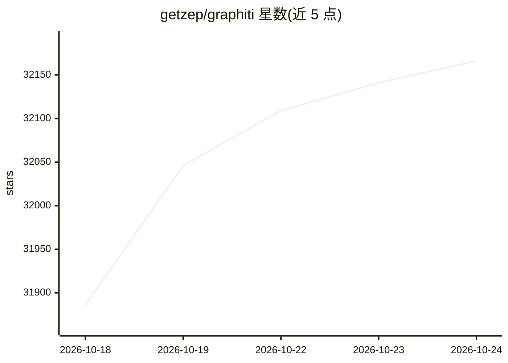

# getzep/graphiti

⭐ 32,180 · Python · Apache-2.0 · 推送 2026-10-24 · [GitHub](https://github.com/getzep/graphiti) · [官网](https://help.getzep.com/graphiti) · 组织维护

**面向 AI agent 的时序知识图谱构建与查询框架**

Graphiti 是构建时序上下文知识图谱的开源框架：从结构化与非结构化数据（用户交互、企业数据、外部信息）自主抽取实体、关系与带时效窗口的事实，增量更新无需全图重算，支持语义+BM25+图遍历的混合检索与历史时刻查询，事实可溯源到原始 episode 数据。本体通过 Pydantic 模型定义或从数据中习得。作为 pip 包安装，需自备图数据库后端（Neo4j/FalkorDB/Neptune）与 LLM 服务，默认 OpenAI。它是商业产品 Zep 的开源核心，自带 MCP 与 REST 参考服务器（明示不适用于生产）。Kuzu 后端已标记弃用。

## 筛选速览

| 维度 | 判定 | 备注 |
|---|---|---|
| AI 角色 | `ai-ecosystem` | LLM/agent 周边工具 |
| 许可风险 | `permissive` | Apache-2.0 |
| 部署形态 | `self-host` | docker 或自建部署 |
| 模型依赖 | local-ok | 支持本地模型 |
| 硬件要求 | — | 无带数字的原话,不猜 |
| 安装摩擦 | `low` | 无编译、无系统依赖或容器化 |
| 成熟度 | — | 结构信号不足 |

## 动量与使用信号

- 维护:`active` — 距上次 push 0.6 天,年发版 38,64 位贡献者
- 涨星:近 1 天 **+80**(自 20261016 起算)
- 安装:pypi 包 `graphiti-core` 月下载 619,128
- 平台:WINDOWS · 协议:OPENAI-API / MCP / OLLAMA

## 能力要点

- 事实带时效窗口，信息变化时旧事实被失效而非删除，支持历史时刻查询
- 增量图构建，新数据实时整合，无需批量重算
- 混合检索：语义嵌入 + BM25 关键词 + 图遍历，不依赖 LLM 摘要
- 支持 Pydantic 预定义本体或从数据习得本体

## 适用场景

- 为 AI agent 构建随交互实时演化的记忆与上下文图谱
- 在频繁变化的企业数据上做带时间维度的知识查询
- 替代批量式 RAG 做增量知识整合与带溯源的检索

## 场景标签

`知识图谱` `Agent 记忆` · 领域:Agent 开发

## 证据(README 行号)

> L27: Graphiti is a framework for building and querying temporal context graphs for AI agents. Unlike static knowledge gr
> L31: Unlike traditional retrieval-augmented generation (RAG) methods, Graphiti continuously integrates user interactions

## 星数曲线

2026-10-18 31,886 → 2026-10-24 32,166（+280）

---
*卡片 v1 · prompt 1.4 · 生成 2026-10-20 · 置信度 mid · 依据 README sha `4a8557842498` · [字段定义](../../DATASET.md)*
