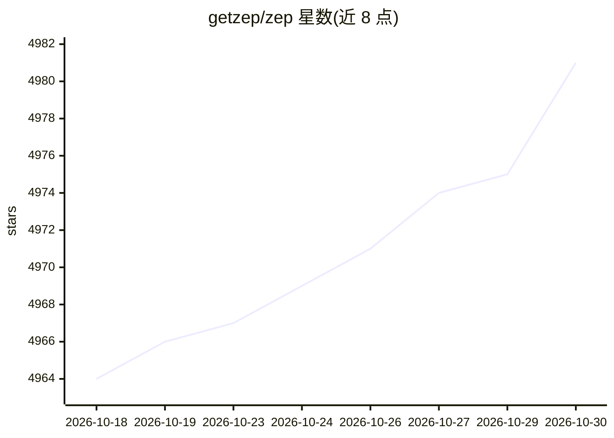

# getzep/zep

⭐ 4,981 · Python · Apache-2.0 · 推送 2026-10-20 · [GitHub](https://github.com/getzep/zep) · [官网](https://help.getzep.com) · 组织维护

**Zep Cloud（托管 agent 记忆平台）的示例与框架集成代码库**

本仓库不是 Zep 产品本身，而是围绕 Zep Cloud（托管的 agent 记忆平台）的示例代码、框架集成包与工具集合。集成包按框架再按语言组织于 integrations/ 目录，每个包独立构建、测试与发布；覆盖 Python（LangGraph、CrewAI、AutoGen、Google ADK 等）、TypeScript（Mastra、Vercel AI SDK 等）与 Go。使用需注册 Zep Cloud 账号；官方 SDK 为 pip/npm/go get 三种。原开源时序知识图谱框架已迁至 Graphiti，Community Edition 已停止支持并移入 legacy/。

## 筛选速览

| 维度 | 判定 | 备注 |
|---|---|---|
| AI 角色 | `ai-ecosystem` | LLM/agent 周边工具 |
| 许可风险 | `permissive` | Apache-2.0 |
| 部署形态 | `library` | 以包/库形式分发 |
| 模型依赖 | — | README 未给出锁定关系 |
| 硬件要求 | — | 无带数字的原话,不猜 |
| 安装摩擦 | `low` | 无编译、无系统依赖或容器化 |
| 成熟度 | — | 结构信号不足 |

## 能力要点

- 集成包按 framework/language 目录组织、独立构建发布
- 覆盖 LangGraph、CrewAI、AutoGen、Google ADK、Mastra 等十余个框架
- 官方 SDK 提供 Python/TypeScript/Go 三种语言

## 适用场景

- 为自己的 agent 框架接入 Zep Cloud 记忆服务时参考集成包
- 学习 agent 记忆的接入示例代码

## 场景标签

`Agent 记忆` · 领域:Agent 开发

## 证据(README 行号)

> L15: This repository is **not** Zep's product or service. It contains **example code, framework
> L16: integrations, and tools** for building agent memory with Zep Cloud,
> L33: Framework integration packages live under `integrations/`, organized

## 星数曲线

2026-10-18 4,964 → 2026-10-30 4,981（+17）

---
*卡片 v1 · prompt 1.4 · 生成 2026-10-20 · 置信度 mid · 依据 README sha `fb6cad39eef4` · [字段定义](../../DATASET.md)*
