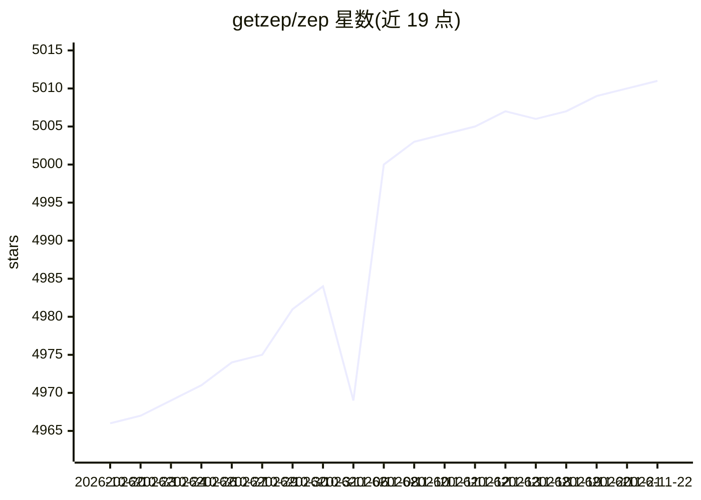

# getzep/zep

⭐ 5,011 · Python · Apache-2.0 · 推送 2026-11-17 · [GitHub](https://github.com/getzep/zep) · [官网](https://help.getzep.com) · 组织维护

**Zep Cloud 的示例与框架集成仓库：帮助开发者接入 agent 上下文层**

本仓库本身不是 Zep 产品，而是 Zep Cloud 的示例代码、agent harness、框架集成包与工具集合。Zep 定位为企业级 agent 上下文层，由 Context Lake（将业务数据统一为受治理的 Context Graphs）与 Zep Agent Skills（将 agent 任务转为可遵循的技能）两部分组成。开发者通过 MCP 或官方 SDK（Python/TypeScript/Go）连接 Zep Cloud，仓库按 framework/language 组织集成包，覆盖多个主流 agent 框架并独立构建发布。

## 筛选速览

| 维度 | 判定 | 备注 |
|---|---|---|
| AI 角色 | `ai-ecosystem` | LLM/agent 周边工具 |
| 许可风险 | `permissive` | Apache-2.0 |
| 部署形态 | `library` | 以包/库形式分发 |
| 模型依赖 | — | README 未给出锁定关系 |
| 硬件要求 | — | 无带数字的原话,不猜 |
| 安装摩擦 | `low` | 无编译、无系统依赖或容器化 |
| 成熟度 | — | 结构信号不足 |

## 能力要点

- 提供 Python/TypeScript/Go 三种官方 SDK 安装方式
- 集成包按 framework/language 目录组织，独立构建测试发布
- 示例覆盖 Context Graph 检索 agent 与 Agent Skills 完整闭环
- 通过 MCP 或 SDK 接入 Zep Cloud

## 适用场景

- 为自己的 agent 接入 Zep Cloud 的企业知识上下文
- 在 LangGraph/Pydantic AI 等框架中添加 agent 记忆
- 参考示例了解 Context Graph 检索与技能循环的用法

## 场景标签

`Agent 记忆` · 领域:Agent 开发

## 证据(README 行号)

> L11: Zep is the enterprise context layer for reliable agents. Zep gives agents
> L24: This repository is **not** Zep's product or service. It contains **example code, agent
> L66: Framework integration packages live under `integrations/`, organized

## 星数曲线

2026-10-20 4,966 → 2026-11-22 5,011（+45）

---
*卡片 v1 · prompt 1.4 · 生成 2026-11-22 · 置信度 high · 依据 README sha `e143e3d384d4` · [字段定义](../../DATASET.md)*
