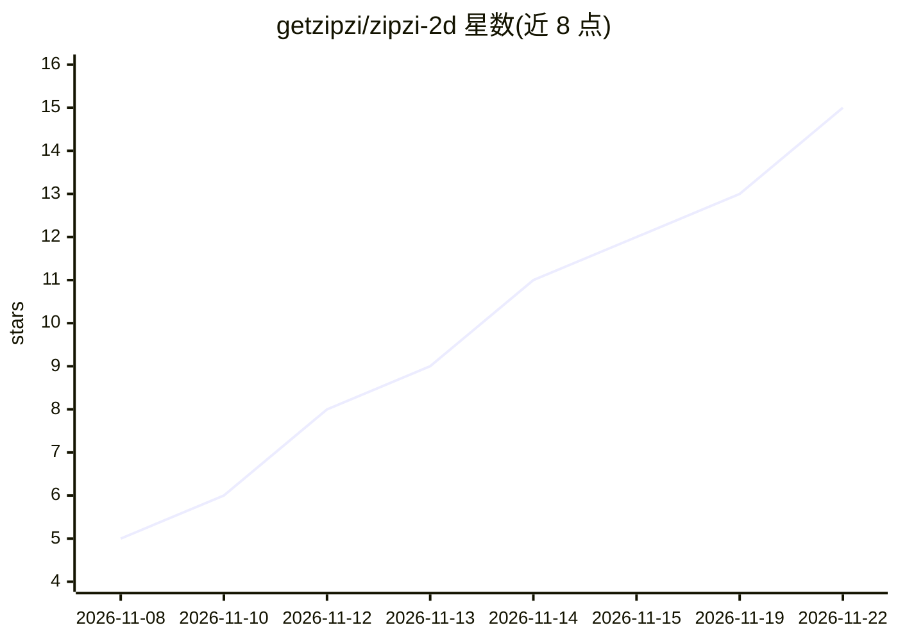

# getzipzi/zipzi-2d

⭐ 15 · Rust · GPL-3.0 · 推送 2026-11-18 · [GitHub](https://github.com/getzipzi/zipzi-2d) · [官网](https://zipzi2d.com) · 个人维护 · 中文 README

**与 AI Agent 协作的开源 2D 建模与动画工具**

用 Rust 与 GPUI 构建的桌面 2D 建模和动画编辑器，定位为 Live2D Cubism Editor 的开源替代，支持网格、参数、变形器、BlendShape、动画物理与姿态创作，支持 PSD 导入与 Cubism 相关格式（Model3/MOC3 等）。核心机制是连接可视化编辑器与 Python SDK/Rust SDK：用户与 AI coding agent 操作同一文档，共享撤销历史，agent 可观察渲染图像并编辑模型；Python 脚本也可脱离编辑器用本地 Runtime 自动化运行。目前为 Alpha 阶段，无稳定版本，API 与文件格式可能变更，编辑器支持 macOS 和 Windows。

## 筛选速览

| 维度 | 判定 | 备注 |
|---|---|---|
| AI 角色 | `ai-enhanced` | 去掉 AI 部分产品仍成立 |
| 许可风险 | `viral` | GPL-3.0 |
| 部署形态 | `None` |  |
| 模型依赖 | — | README 未给出锁定关系 |
| 硬件要求 | — | 无带数字的原话,不猜 |
| 安装摩擦 | `low` | 无编译、无系统依赖或容器化 |
| 成熟度 | `idea` | |

## 能力要点

- 编辑器与 Python SDK 共享同一模型文档与撤销历史，支持 AI agent 协作编辑
- Python/Rust 双 SDK 支持程序化建模、动画创作、预览与检查
- 支持 PSD 导入及 Model3/MOC3 等 Cubism 相关格式（有损规则因格式而异）
- MIT 许可的 SDK，可商用创建和使用模型

## 适用场景

- 让 AI coding agent 通过 Python SDK 为网格批量命名或执行批量编辑
- 制作和精修 Live2D 风格的 2D 模型与动画
- 脱离编辑器用 Python 脚本自动化处理模型项目
- 从 PSD 导入素材并生成/手工精修网格几何

## 场景标签

 · 领域:创意工具/2D 建模与动画

## 证据(README 行号)

> L5: **An open-source 2D modeling and animation tool for creating alongside AI.**
> L7: You shape the artwork. Your AI agent helps with the modeling work. Zipzi connects
> L25: - **Agent-ready** — Create from scratch, collaborate with AI, or import an

## 星数曲线

2026-11-08 5 → 2026-11-22 15（+10）

---
*卡片 v1 · prompt 1.4 · 生成 2026-11-18 · 置信度 high · 依据 README sha `caf0371fb4f1` · [字段定义](../../DATASET.md)*
