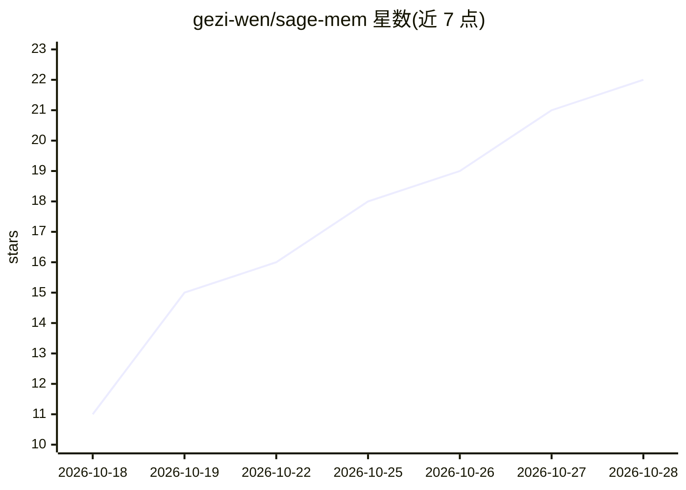

# gezi-wen/sage-mem

⭐ 23 · JavaScript · Apache-2.0 · 推送 2026-10-28 · [GitHub](https://github.com/gezi-wen/sage-mem) · [官网](https://www.npmjs.com/package/sage-mem) · 个人维护 · 中文 README

**DeepSeek Harness 的跨会话记忆插件：纯 Markdown 文件存储**

为 DeepSeek Harness（DSH）提供的文件式长期记忆插件：DSH 原生无记忆系统，每次新会话均从零开始。sage-mem 将记忆以一张 .md 文件（YAML frontmatter + 正文）形式存于本地目录（默认 ~/.sage-mem/memory），每轮对话前自动两阶段检索（描述评分 + BM25 段落检索）注入最相关段落；同时提供 search_memory/read_memory 工具供模型主动查阅。无数据库、无 worker、无额外端口，运行时依赖仅 zod。支持冲突不覆盖、锁定、归档、审计、autodream 整理与 Claude Code 迁移。要求 DSH 0.1.2-rc.1+ 与 Node.js >= 18。

## 筛选速览

| 维度 | 判定 | 备注 |
|---|---|---|
| AI 角色 | `ai-ecosystem` | LLM/agent 周边工具 |
| 许可风险 | `permissive` | Apache-2.0 |
| 部署形态 | `library` | 以包/库形式分发 |
| 模型依赖 | locked-api |  |
| 硬件要求 | — | 无带数字的原话,不猜 |
| 安装摩擦 | `low` | 无编译、无系统依赖或容器化 |
| 成熟度 | — | 结构信号不足 |

## 能力要点

- 纯 Markdown 文件存储，可用编辑器/git 直接管理，无数据库无 worker
- 两阶段检索自动注入（描述评分 + BM25 段落检索），按段落而非整文件注入
- 并发写入冲突不覆盖，留待人工裁决
- 四类记忆（user/feedback/project/reference），单文件 512KB 双侧校验

## 适用场景

- 让 DSH 助手跨会话记住用户偏好与项目进度
- 把记忆目录放进 git 仓库随项目迁移与备份
- 从 Claude Code 迁移 persona 与记忆文件

## 场景标签

`Agent 记忆` · 领域:Agent 开发

## 证据(README 行号)

> L24: DSH has no native memory system. Every new session is a blank sheet: it does not remember who you are, where you go
> L26: sage-mem adds that layer, like this: **write down the things worth remembering as cards, and store them on your own
> L52: |**Zero extra services**|No worker, no SQLite, no port, no long-running process, and no extra API key or cloud serv

## 星数曲线

2026-10-18 11 → 2026-10-28 22（+11）

---
*卡片 v1 · prompt 1.4 · 生成 2026-10-28 · 置信度 high · 依据 README sha `0092ad153f3e` · [字段定义](../../DATASET.md)*
