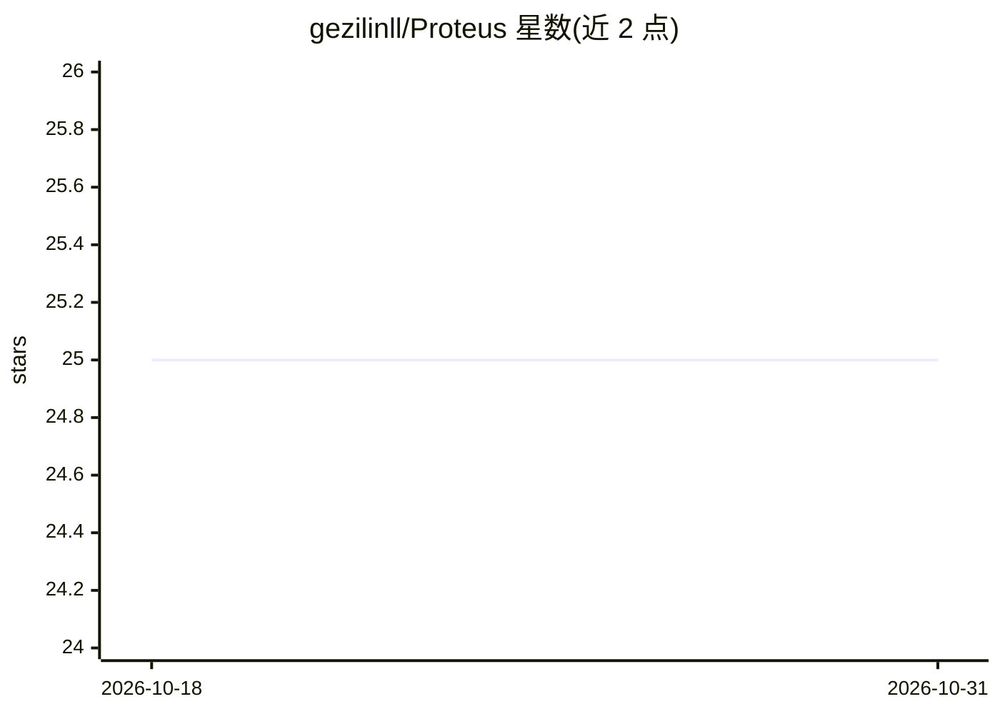

# gezilinll/Proteus

⭐ 25 · TypeScript · MIT · 推送 2026-08-16 · [GitHub](https://github.com/gezilinll/Proteus) · 个人维护 · 中文 README

**公开构建中的 AI-ready 多模态画布编辑器核心**

以 Web demo 验证编辑器核心能力的开源项目，产品路径为『可保存文档 -> AI 助手 -> 自定义 AI 能力 -> 多模态画布』。已完成基础画布编辑：矩形/圆形/文本/图片元素、选择拖拽缩放、图层、复制粘贴、撤销重做等。当前主线为文档保存，下一阶段规划自然语言操控画布的 AI 助手，并定义统一动作协议、审批 hook 与 Provider/MCP/Skill/Plugin 契约。工程上采用 Monorepo、框架无关 core 与 React 绑定，通过 git clone 源码本地运行，MIT 许可。

## 筛选速览

| 维度 | 判定 | 备注 |
|---|---|---|
| AI 角色 | `ai-enhanced` | 去掉 AI 部分产品仍成立 |
| 许可风险 | `permissive` | MIT |
| 部署形态 | `None` |  |
| 模型依赖 | — | README 未给出锁定关系 |
| 硬件要求 | — | 无带数字的原话,不猜 |
| 安装摩擦 | `low` | 无编译、无系统依赖或容器化 |
| 成熟度 | `idea` | |

## 能力要点

- Phase 1 画布编辑能力已完成：图形/文本/图片元素与主要交互
- 定义动作协议、审批 hook、只读查询接口以支撑 AI 驱动
- 规划 Provider / MCP / Skill / Plugin 统一契约与自定义 LLM 接入
- 框架无关 core + React 绑定，Vitest 测试，在线 demo 可体验

## 适用场景

- 在浏览器画布中创建和编辑图形、文本与图片
- 关注可被 Agent/LLM/MCP 安全驱动的编辑器核心架构
- 通过契约扩展接入自定义 LLM、MCP、Skill 或插件（规划中）

## 场景标签

 · 领域:编辑器/内容创作工具

## 证据(README 行号)

> L16: |产品路径|`可保存文档 -> AI 助手 -> 自定义 AI 能力 -> 多模态画布`|
> L17: |AI-ready 含义|可被 Agent / LLM / MCP / Skill 安全驱动，而不是先堆很多 AI 功能|
> L47: |M3 AI 助手|用自然语言选择、移动、对齐、重排画布内容|下一阶段|

## 星数曲线

2026-10-18 25 → 2026-10-31 25（+0）

---
*卡片 v1 · prompt 1.4 · 生成 2026-10-27 · 置信度 high · 依据 README sha `818126f90308` · [字段定义](../../DATASET.md)*
