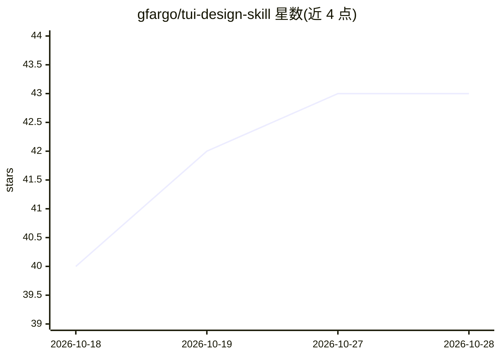

# gfargo/tui-design-skill

⭐ 43 · Python · MIT · 推送 2026-10-27 · [GitHub](https://github.com/gfargo/tui-design-skill) · [官网](https://griffen.codes/post/tui-design-skill-claude/) · 个人维护

**面向 agent 的终端 UI/CLI 设计技能包，覆盖四语言生态**

供 Codex、Claude 及兼容技能机制的 agent 使用的 SKILL.md 技能：提供终端 UI 与 CLI 的设计、构建、评审与库选型知识。核心为 139 行 SKILL.md 承载工作流与路由表，按需加载 9 个参考文档（约 4,400 行），覆盖 Bubble Tea、Ratati、Textual、Ink 等 Go/Rust/Python/TypeScript 生态及布局、配色、键绑定等通用模式。通过 Claude Code 插件市场、npx skills、.skill 上传或 git clone 安装；构建与校验依赖 Bash/zip 及 Python 3.9+。

## 筛选速览

| 维度 | 判定 | 备注 |
|---|---|---|
| AI 角色 | `ai-knowledge` | 知识聚合/清单类 |
| 许可风险 | `permissive` | MIT |
| 部署形态 | `library` | 以包/库形式分发 |
| 模型依赖 | — | README 未给出锁定关系 |
| 硬件要求 | — | 无带数字的原话,不猜 |
| 安装摩擦 | `low` | 无编译、无系统依赖或容器化 |
| 成熟度 | — | 结构信号不足 |

## 能力要点

- 渐进式加载：SKILL.md 路由 + 9 个按需参考文档
- 覆盖 Bubble Tea/Ratatui/Textual/Ink 四大 TUI 生态
- CI 对参考文档中代码示例按锁定框架版本编译验证
- 内置带断言规则的评测集与供应方中立的评测 harness

## 适用场景

- 让 Claude Code/Codex 在我写 TUI 时自动给出设计评审
- 在 Bubble Tea、Ratatui、Textual、Ink 之间做选型决策
- 新建终端应用时获得布局、配色、键绑定的规范约束

## 场景标签

 · 领域:开发工具/agent 技能

## 证据(README 行号)

> L8: An agent skill for designing and building **clean, professional, minimal terminal UI (TUI) applications and command-
> L27: The skill uses progressive disclosure: its 139-line `SKILL.md` carries the workflow, routing table, and cross-cutti

## 星数曲线

2026-10-18 40 → 2026-10-28 43（+3）

---
*卡片 v1 · prompt 1.4 · 生成 2026-10-25 · 置信度 mid · 依据 README sha `1c5af2783531` · [字段定义](../../DATASET.md)*
